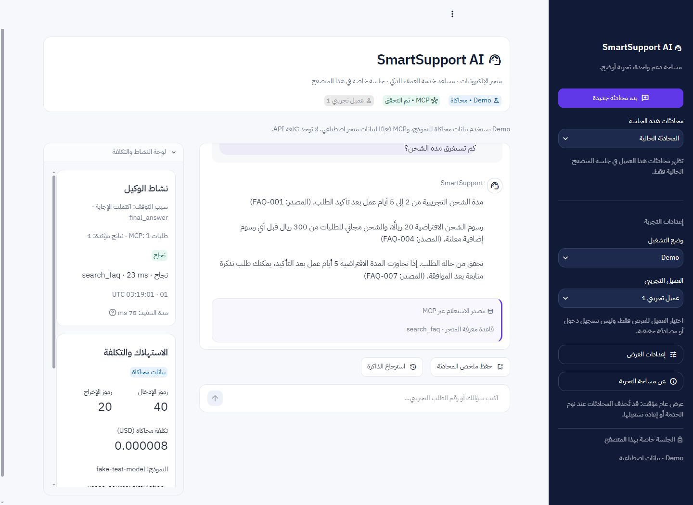

# SmartSupport AI

## حدود استهلاك الوكيل الحالية

الحدود المفروضة داخل `Agent`، ويمكن خفضها فقط: `MAX_AGENT_TURNS=4`،
`MAX_OUTPUT_TOKENS=350`، `MAX_INPUT_TOKENS=3000`، `MAX_TOOL_CALLS=3`،
`MAX_HISTORY_MESSAGES=6`، `MAX_TOOL_RESULT_CHARS=2000`،
`MAX_TASK_COST_USD=0.005`، `MAX_DAILY_COST_USD=0.10`، `MAX_API_RETRIES=0`.
إعادة SDK والتطبيق معطلتان، بما فيها أخطاء429. أسماء الإعدادات القديمة
`MAX_TURNS` و`BUDGET_USD` مقبولة للتوافق مع خفضها إلى السقف الجديد؛ لا تستطيع
القيم القديمة رفع السقف. حُدّث `.env.example` وملف `.env` المحلي دون كشف المفتاح.

عداد الإدخال محلي باستخدام `tiktoken` وبيانات o200k محفوظة مع التحقق من البصمة،
ويحسب التعليمات والأدوات والسياق مع هامش framing. ليس عداد OpenAI الرسمي أو ضمانًا
رياضيًا للتكلفة. قد يتجاوز الطلب الجاري التقدير؛ يسجل الاستهلاك الفعلي ويوقف
الاستدعاءات التالية عند تجاوز الحد. لا يُجرى طلب عد رموز عبر OpenAI تلقائيًا.

السجل اليومي `data/daily_api_cost.sqlite3` مستقل عن متجر MCP، ومشترك بين العمال
وعمليات التطبيق على الجهاز نفسه. غيّر `DAILY_COST_DB_PATH` إلى قرص دائم موثوق عند
التشغيل الفعلي. SQLite `BEGIN IMMEDIATE` يحجز تكلفة كل طلب قبل إرساله ثم يسويها
من usage؛ الأخطاء الملتبسة تبقي الحجز دون إلغائه تلقائيًا، حتى بعد منتصف الليل.
اليوم بتوقيت Asia/Riyadh. فشل السجل يمنع الإنفاق؛ لا تسجل فيه رسائل أو مفاتيح.
Fake OpenAI لا يستهلك الحصة الحقيقية. هذا ليس عدادًا موزعًا بين أجهزة مستقلة.

تاريخ المحادثة يمر كرسائل منفصلة؛ حد6 يخص رسائل user/assistant ويشمل السؤال
الحالي. تبقى تبادلات function_call/output وreasoning مترابطة، وتدخل كلها في حد
الإدخال. لا تُقص رموز الموافقة أو المعاملات أو معرفات الاستدعاء. نتائج FAQ تُختصر
بحذف نتائج كاملة أقل ترتيبًا؛ الذاكرة الطويلة قد تعاد كمقتطف موسوم بوضوح دون تغيير
المحفوظ في DB. إذا لم تتسع حقيقة كاملة أو معرفات لازمة تعاد `RESULT_TOO_LARGE`.

استدعاءات القراءة المكررة في دفعة واحدة تستخدم نتيجة داخل المهمة فقط؛ تكرارها
عبر جولات النموذج دون كتابة يوقف الحلقة. الكتابة تبطل ذاكرة القراءة المؤقتة.
يمكن للمستدعي الموثوق استخدام `Agent.run(..., request_id=...)` لمنع تنفيذ الإرسال
نفسه مرتين بالتزامن داخل كائن الوكيل؛ معرف واحد مع محتوى مختلف يُرفض. ليس ذلك
بديلًا عن idempotency دائم للكتابات عبر إعادة تشغيل التطبيق.

راجع [تقرير التحسين والاختبارات](reports/token_optimization.md). النتائج المحلية
لا تثبت انخفاض تكلفة OpenAI الحقيقية؛ سجل FAQ السابق بقي دون تغيير.

مشروع تخرج لوكيل ذكاء اصطناعي واحد يخدم عملاء متجر إلكترونيات افتراضي باستخدام Python وOpenAI API وMCP وSQLite وStreamlit.

**الحالة الحالية: منشور في GitHub، وغير منشور على Render.** الإصدارات: **`streamlit==1.66.1`** و**`openai==2.54.0`** و**`mcp==1.27.2`**، مع Python **3.13.7**. Demo لا يحتاج مفتاحًا؛ إعداد Render يقفل Live. الآثار الثلاثة الأصلية محفوظة وموسومة كمحاكاة. يوجد قياس سابق لمهمة OpenAI واحدة في `traces/live_success_1.jsonl`؛ لم يُنفذ طلب API في هذا التدقيق. راجع [مستودع GitHub](https://github.com/f5551/smartsupport-ai) و[تقرير الجاهزية](deployment_readiness.md) و[المراجعة النهائية](reports/capstone_final_audit.md).

## واجهة SmartSupport AI SaaS 3.0

واجهة عربية بهوية كحلية `#111B38` وبنفسجية `#6038E8`، وخلفية `#F7F8FC` وبطاقات بيضاء وحدود `#E5E8F1`، ونص `#20283D` وثانوي `#68738A`. على الكمبيوتر: تنقل ثابت يمينًا، ومحادثة أكبر في الوسط، ونشاط وتكلفة يسارًا بتمرير مستقل. على الهاتف تتقدم المحادثة، وتأتي لوحة النشاط في قسم قابل للطي، والتنقل في قائمة Streamlit الأصلية. لا تُقرأ هوية أو صلاحيات من أبعاد الشاشة أو خيارات العرض.

أُضيف خط **IBM Plex Sans Arabic** بوزني 400 و600 دون تعديل، من [مستودع Google Fonts الرسمي](https://github.com/google/fonts/tree/main/ofl/ibmplexsansarabic)، مع ترخيص SIL OFL 1.1 الكامل في `assets/fonts/OFL.txt` وبصمات الملفات في `assets/fonts/README.md`. يُضمّن من ملفات محلية داخل CSS، دون طلب خارجي من متصفح الزائر، ومع بدائل Tahoma وArial وsans-serif. يبقى `enableStaticServing=false`؛ لا تُفتح ملفات الخادم للتصفح. يدعم التصميم المظهرين الفاتح والداكن. لم تكن صورة المرجع المذكورة متاحة في المرفقات، فاعتمد التنفيذ لوحة الألوان والتخطيط النصيين.

الشريط الجانبي يضم محادثة جديدة واختيار العميل التجريبي والمحادثات السابقة الخاصة بنفس العميل والزائر. الأرشيف **للقراءة فقط**، ويمكن استعادته بعد إعادة تشغيل الخادم إذا بقيت الملفات والجلسة صالحة وقُدم سر استعادتها المستقل؛ لا يستأنف موافقات قديمة ولا يسترد حساب عميل. بدء محادثة جديدة أو تغيير العميل ينشئ سياقًا معزولًا كما سابقًا. إعدادات العرض تتيح إخفاء النشاط والتكلفة أو إظهار مربع نسخ آخر إجابة باستخدام `st.code` وزر النسخ الأصلي؛ لا توجد JavaScript للحافظة.

للمظهر الداكن افتح قائمة **⋮ → Theme → Dark**؛ المظهر خاص بالزائر ولا يغير وضع Demo أو الصلاحيات. `toolbarMode=viewer` يبقي خيارات العرض ويخفي خيارات المطور مثل clear cache وdeploy. تبقى ملفات static والسجلات والقواعد غير متاحة للتحميل.

مؤشر MCP يبدأ «لم يُتحقق بعد» ويتغير فقط بعد نجاح تهيئة اتصال حقيقي؛ عبارة «تم التحقق» تعني آخر تهيئة في هذه الجلسة، وليست مراقبة صحة مستمرة. لوحة النشاط تعرض عدد طلبات MCP والنتائج المؤكدة ونجاح/فشل كل أداة ومدتها ورمز خطأ آمن، مشتقة من أحداث التدقيق المسموحة. إذا لم تصل نتيجة لا تُعد نجاحًا. مدة التنفيذ مقاسة في عامل التشغيل، وتستبعد انتظار المستخدم للموافقة. لا تُعرض خطوات تفكير النموذج أو معاملات الأدوات أو رموز الموافقات.

تُعرض نتائج الأدوات بتوقيتها الفعلي UTC من سجل التدقيق وبترتيب صدورها، وتُعرض حالة انتظار الموافقة كحالة تطبيق دون اختراع استدعاء أداة. بطاقة «مصدر الاستعلام» تذكر الأدوات الناجحة المرتبطة بآخر نتيجة فقط؛ لا تُنشأ إحالات FAQ موثقة من تخمين النص. لوحة الميزانية تستخدم الحد الفعلي من إعداد المهمة والتقدير من CostTracker، وتحسب المتبقي بـDecimal؛ ليست ضمانًا لسقف فاتورة API.

لوحة التكلفة تعرض input_tokens وoutput_tokens وestimated_cost_usd والنموذج وusage_source من نتيجة التنفيذ. تظهر «بيانات محاكاة» عندما يكون المصدر simulation، دون وصفها كقياسات فاتورة. Live لا يظهر إلا مع سياسة المشغل المحلية وإعداد نموذج وتسعير ومفتاح صالحين من حيث التهيئة؛ لا يتم التحقق من صلاحية المفتاح عبر API حتى يختار المشغل تنفيذًا حقيقيًا مصرحًا به. النشر العام يظل Demo فقط.

تنفذ أزرار الأسئلة المقترحة حلقة الوكيل وMCP الحالية، وتظل بطاقة الشكوى/الذاكرة منفصلة قبل التأكيد. الإدخال وأزرار الذاكرة معطلة أثناء pending، ومخزن الموافقات يمنع إعادة الاستخدام. نصوص العميل والوكيل تعرض باستخدام `st.text` أو `st.code`، دون HTML غير موثوق.

راجع [تقرير واجهة SaaS](saas_ui_review.md) للاختبارات والمعاينات الحالية؛ [تقرير واجهة 2.0](ui_review.md) توثيق للتسليم السابق. عند ترقية نسخة تعمل بالفعل أعد تشغيل Streamlit لتحميل الوحدات الجديدة. بقي الوكيل وSQLite والصلاحيات والموافقات والأدوات الست وشروط الكابستون وسجلات JSONL الأصلية دون تغيير وظيفي. لم تُنفذ API مدفوعة أو عملية نشر.

نتيجة المجموعة الكاملة لواجهة SaaS: **231 passed، 0 failed، 2 skipped** (API المدفوع وLinux). فحص الاعتماديات والمسح النصي لملفات الإصدار سليمان. القياسات والمتصفحات المختبرة موثقة في التقرير؛ لا تعني محاكاة مقاس الهاتف اختبار جهاز فعلي أو جميع المتصفحات.



[حالة البداية](artifacts/saas-desktop-empty.jpg) · [معاينة الهاتف](artifacts/saas-mobile.jpg) · [بطاقة الموافقة](artifacts/saas-approval-mobile.jpg)

## تشغيل واجهة Demo على Windows PowerShell

### انتهاء تسجيل الزائر وتنظيف السعة

مدة خمول الزائر الافتراضية **30 دقيقة**. يمكن للمشغّل ضبطها قبل بدء الخادم:

```powershell
$env:SMARTSUPPORT_VISITOR_IDLE_SECONDS = "1800"
```

هذه سياسة خادم وليست قيمة يحددها المتصفح؛ ملف `.env` وحده لا يغيرها عند بدء
الواجهة. يجب أن تكون المدة موجبة ومحدودة؛ الإعداد غير الصحيح يمنع تهيئة الخدمة.
إذا كانت نسخة Streamlit تعمل بالفعل، يلزم إعادة تشغيلها في وقت مناسب لتحميل
كائن Backend الجديد؛ لا تنفذ هذه المراجعة إعادة تشغيل خادم قائم أو نقل جلساته.

يُفحص الخمول بساعة monotonic عند تسجيل زائر جديد وعند كل عملية جلسة، وقبل
اختبار حد **64 تسجيلًا صالحًا**. توجد أيضًا `cleanup_expired_visitors()` لتنظيف
صريح في طبقة التشغيل. لا يوجد حذف دوري للملفات أو خيط تنظيف إضافي.

كل عملية تحمل حجزًا مؤقتًا لهوية الزائر منذ الدخول، بما فيه انتظار قفل المحادثة
وتهيئة SQLite ونداء MCP وقرار الموافقة. لا تنتهي الهوية أثناء العملية؛ يجدد
آخر النشاط عند إكمالها، حتى عند الخطأ. عامل ما زال يعالج طلبًا بعد مهلة مستدعيه
يبقى محميًا أيضًا. القراءة والعرض والتاريخ تُعد نشاطًا؛ بقاء تبويب مفتوح بلا
طلبات لمدة الخمول لا يجدد الجلسة.

التنظيف يسحب تسجيل الزائر المنتهي فقط ويغلق عماله الخاملين خارج أقفال السجل
والمحادثة. **لا يحذف المحادثات أو الرسائل أو SQLite أو الذاكرة أو الموافقات أو
سجلات JSONL**. لا يمكن استعمال معرف منتهٍ أو معرف محادثة قديمة لاستعادتها؛ مسار
إعادة التهيئة الموجود في الواجهة ينشئ هوية ومحادثة جديدتين. تظل المحادثات المحفوظة
غير متاحة لزائر جديد، ولا تُنقل ملكيتها.

حد إنشاء المحادثات **128 للتسجيلات الصالحة، شامل حجوزات الإنشاء المتزامن**؛
المحادثات التابعة لتسجيلات انتهت لا تحجز هذه السعة. هذا ليس حدًا لحجم الأرشيف
المحتفظ به في الذاكرة أو القرص؛ سياسة احتفاظ/أرشفة مستقلة ما زالت مطلوبة دون
حذف تلقائي في هذه المرحلة. حد العمال وتقييد الاستخدام اليومي والعام والموافقات
لا تتغير بالتنظيف.

من مجلد المشروع بعد تثبيت الاعتماديات في البيئة الافتراضية:

لنسخة جديدة أنشئ البيئة أولًا بـ`py -3.13 -m venv .venv` (Python 3.13.7 هو إصدار التحقق الحالي).

```powershell
.\.venv\Scripts\python.exe -m pip install -r requirements.txt
.\.venv\Scripts\python.exe -m streamlit run app.py --server.address 127.0.0.1 --server.port 8501
```

افتح [الواجهة المحلية](http://127.0.0.1:8501). لا تحتاج Demo إلى `.env` أو مفتاح OpenAI؛ إنشاء قاعدة التجربة تلقائي ومحصور في مساحة المحادثة، ولا يعيد تهيئة قاعدة العرض الأصلية. جرّب «ما مدة الشحن؟» أو «ما حالة الطلب DEMO-1001؟» مع العميل التجريبي الأول.

في Demo يستخدم `DemoOpenAI` عميل Fake OpenAI الموجود لتوليد ردود محاكاة تفاعلية؛ الحقائق المعروضة تأتي من نتائج أدوات MCP الحقيقية. ليست هذه الردود تقييمًا لجودة نموذج OpenAI فعلي. الواجهة تُظهر علامة المحاكاة وعدد الرموز الاصطناعي وتكلفة المحاكاة وسبب التوقف والأدوات المستخدمة بوضوح.

### الموافقة والذاكرة في الواجهة

طلب شكوى مثل «إنشاء شكوى للطلب DEMO-1002 بسبب عطل الشاشة» يجهز تفاصيل المراجعة فقط. زر **تأكيد إنشاء الشكوى** يصدر موافقة مرتبطة بنفس العميل والجلسة والمحتوى، ثم يستدعي `Agent.resume`. زر **إلغاء العملية** يستكمل المهمة بالرفض دون إنشاء تذكرة. لا تُعرض مراجع الموافقة أو تُسجل في الواجهة.

مطالبة واحدة لها قرار واحد محفوظ في SQLite قبل إصدار الموافقة، إضافة إلى استهلاك الموافقة داخل خادم MCP. إعادة عرض الصفحة أو تكرار إرسال نفس قرارها لا يعيد الكتابة. بعد المرحلة الثالثة يسجل MCP مفتاح idempotency ونتيجة العملية بشكل دائم؛ الاستدعاء المطابق يعيد النتيجة السابقة بلا تذكرة جديدة، وتُصالح النتيجة المجهولة من سجل المتجر قبل أي محاولة أخرى.

زر **حفظ ملخص المحادثة** يجهز `save_memory` عبر الوكيل وMCP، ويطلب تأكيد حفظ منفصلًا. **استرجاع الذاكرة** يستخدم `load_memory` من نفس العميل والجلسة. بصورة مستقلة، تُحفظ رسائل العرض المنقحة ونتائج المهام تلقائيًا في سجل جلسات SQLite خاص للاستعادة المصرح بها؛ هذا ليس استدعاءً لأداة حفظ الذاكرة ولا يمنح أي موافقة كتابة للوكيل. تغيير العميل أو بدء محادثة جديدة ينشئ سياقًا خاصًا جديدًا ويحتفظ بالأرشيف المعزول.

إذا انتهت عملية الوكيل أو فُقدت حالة pending، يُرفض الاستكمال قبل إصدار موافقة جديدة وتظهر رسالة فقد الحالة دون ادعاء نجاح. إعادة العرض العادية تحافظ على الكائن الحي؛ عامل الوكيل يغلق بعد 3 دقائق خمول. يمكن إعادة فتحه لقراءة الذاكرة المصرح بها في نفس السياق، لكن عملية pending القديمة لا تستعاد للتنفيذ. بعد إعادة تشغيل backend، تتحول الموافقة المعلقة إلى `cancelled` مع طلب إجراء جديد؛ وتتحول المهمة الجارية إلى `failed/interrupted` بنتيجة مجهولة، دون أي إعادة تلقائية لـOpenAI أو MCP. النتيجة المكتملة أو الفاشلة أو الملغاة تُستعاد كما سُجلت فقط.

### استعادة الجلسة بعد إعادة التشغيل

احفظ **معرف هذه الجلسة** و**سر هذه الجلسة** من الشريط الجانبي في مكان خاص. السر عشوائي مستقل (256 بت)، ولا يُحفظ في SQLite إلا SHA-256 له. لا تضعه في رسالة أو رابط أو سجل؛ لا ترسله إلى شخص آخر. سجل `web_sessions.sqlite3` داخل مجلد تشغيل الويب يحفظ الملكية وسياق المحادثة وحالة المهمة. لا تكفي معرفة معرف محادثة أو `session_id` أو معرف الزائر لاستعادة الملكية. لا يوجد استرداد للسر المفقود أو مصادقة حسابات إنتاجية.

عند فقد `st.session_state` بعد إعادة تشغيل Python أو إعادة تحميل المتصفح، استخدم **استعادة جلسة محفوظة** وأدخل المعرف والسر. عند إعادة إنشاء مورد Streamlit فقط، يمكن استخدام الإثبات الباقي في حالة المتصفح تلقائيًا لاستعادة العرض، دون تنفيذ مهمة. الجلسة المنتهية أو الملغاة تُرفض حتى بالسر الصحيح؛ لا يمدد بدء الخادم عمرها. لا يمكن ترحيل محادثات النسخة السابقة بأمان: لم تكن تملك سجل ملكية دائمًا أو سر استعادة؛ تبقى ملفاتها دون فتحها لزائر جديد.

كل إرسال له `web_task_id` فريد، ويقبل backend `request_id` لإعادة نفس الطلب بنتيجته المسجلة دون تنفيذ آخر. قرار الموافقة يُحجز في SQLite قبل إصدار أي grant؛ صلاحية عرض العملية 120 ثانية، والتفاصيل مرتبطة ببصمة لا تسمح بتغييرها. تُفحص ثانية داخل العامل قبل الإصدار. يحتفظ MCP بمفتاح idempotency ثابت مربوط بالعميل والجلسة والأداة والحمولة؛ قاعدة المتجر تحفظ التذكرة/الذاكرة وإيصالها في معاملة واحدة. لا يعني ذلك ذرّية بين ملف الموافقات وملف المتجر أو exactly-once موزعًا. عند unknown يفحص النظام سجل المتجر ولا يكرر الكتابة تلقائيًا؛ إذا تعذر التحقق تبقى العملية fail-closed لمراجعة المشغل.

يشترط السجل **مالك backend واحدًا للمجلد** بقفل نظام التشغيل (`session_registry.lock`)؛ backend ثانٍ يرجع `busy` بدل انتزاع ملكية عملية حية. القفل يتحرر عند انهيار العملية ولا يُحذف ملفه يدويًا لتجاوز المالك. SQLite يستخدم معاملات `BEGIN IMMEDIATE` و`FULL` للحالة؛ لا ترحيل لمكدس coroutine أو طابور استدعاءات أو مراجع موافقات حية. تحفظ عدادات التكلفة اليومية وحجوزاتها غير المحسومة في سجلها القائم دون تصفير أو تقدير نجاح. الاستمرار يتطلب بقاء الملفات على تخزين موثوق وصلاحيات نظام ملفات خاصة؛ تعدد المضيفين وملفات NFS والاستعادة بعد فقد القرص غير مدعومة بهذه الآلية.

### تفعيل Live محليًا فقط

هذه تعليمات جاهزة للمشغل **عند وجود تصريح باستخدام API**؛ لم تُنفذ طلبات مدفوعة في هذا التسليم. اضبط `.env` بالمفتاح والنموذج والسعر الموثق كما في قسم إعداد الوكيل. لا توجد حقول للزوار لإدخال المفتاح أو تغيير النموذج.

```powershell
$env:SMARTSUPPORT_DEPLOYMENT = "local"
$env:SMARTSUPPORT_ENABLE_LOCAL_LIVE = "1"
.\.venv\Scripts\python.exe -m streamlit run app.py --server.address 127.0.0.1 --server.port 8501
```

يظهر خيار Live فقط إذا تحققت رايتا المشغل وربط الخادم بـ`127.0.0.1` أو`::1`. تُفحص السياسة في الخادم عند إنشاء المحادثة وكل عملية، وليست مجرد إخفاء زر. وضع `public` أو ربط `0.0.0.0` يمنع Live حتى مع الراية. رايات تشغيل الواجهة تُقرأ من **بيئة العملية** عمدًا، ولا يكفي وضعها داخل `.env` لفتح وضع مدفوع. لا تعرض منفذ Live عبر نفق أو reverse proxy عام؛ لا توجد مصادقة إنتاجية تحمي ذلك.

Live يستخدم Responses API والاسم المضبوط لدى المشغل، ويعرض الاستهلاك الحقيقي إذا أعادته API والتكلفة المحسوبة بأسعاره. حد الميزانية تقديري، ولا يضمن سقف الفاتورة النهائي. لإغلاق Live أوقف الخادم واحذف الرايات أو اضبط `SMARTSUPPORT_ENABLE_LOCAL_LIVE=0` قبل إعادة التشغيل.

اختبار مستقل جاهز بعد الإذن الصريح، ولا ينفذ دون راية التفويض:

```powershell
.\.venv\Scripts\python.exe live_smoke.py --allow-paid
```

هذا تدفق واحد بحد أقصى استدعاءي نموذج، وحد إخراج 128 رمزًا لكل استدعاء، ودون إعادة محاولة، وميزانية تقديرية 0.005 دولار قد تمنع الطلب قبل إرساله. يستخدم قاعدة مؤقتة وMCP فعليًا، ويطبع النموذج وعدادات input/output/cache والتكلفة ونتيجة الوصول إلى MCP واكتمال الرد؛ التدقيق المنقح في `logs/`. لم يُشغّل الأمر المدفوع هنا. `pytest` الافتراضي يبقي اختبار API الاختياري متجاوزًا.

### حدود الواجهة قبل النشر

- العملاء الخمسة قائمة بيانات اصطناعية للعرض، وليست مصادقة أو حسابات حقيقية. لا توجد معرفات أو مسارات حرة يحددها الزائر.
- لكل محادثة قاعدة متجر وموافقات وتدقيق خاصة في `data/web_demo/<معرّف عشوائي>/`؛ الملكية تُراجع في خادم MCP، ولا تُعاد مشاركة كائن وكيل بين عميلين. موارد السجل المشتركة تتحقق من ملكية جلسة المتصفح قبل الوصول.
- حدود التنفيذ في SQLite مستقلة عن `session_state`: 1000 محرف للرسالة، و10 عمليات في الدقيقة، و30 لكل جلسة متصفح، و120 عملية عامة في الساعة. يشمل ذلك إنشاء المحادثة وقرارات الموافقة؛ بدء محادثة جديدة لا يصفر عداد الزائر.
- حد أقصى 4 عوامل تشغيل نشطة و64 تسجيل زائر صالحًا و128 محادثة محسوبة للتسجيلات الصالحة؛ التسجيلات المنتهية تُنظف وفق مدة الخمول دون حذف المحادثات المحتفظ بها. هذه حماية تجربة محدودة وليست نظام مكافحة إساءة استخدام موزعًا. لا توجد هوية موثوقة لمنع زائر من إنشاء جلسة متصفح جديدة، لكن يبقى الحد العام مستمرًا في SQLite.
- عرض النصوص دون HTML، وحجب أنماط المفاتيح، ورفض مفاتيح API في مدخل الرسالة، ورسائل أخطاء ثابتة دون استثناءات أو مسارات. لا رفع ملفات أو تصفح قواعد أو تنزيل سجلات في الواجهة، وخدمة الملفات الساكنة معطلة.
- تحتاج الإتاحة العامة إلى مصادقة إنتاجية، واحتفاظ/تنظيف لمساحات التجربة وعدادات التحكم، وتخزين مستمر ومراقبة موارد وحدود نشر أوسع. أبقِ Live مغلقًا على الرابط العام. لا يوجد نشر Render في هذه المرحلة.

## الهدف والتصميم المخطط

الإجابة من قاعدة معرفة، والاستعلام عن الطلبات المملوكة للعميل، وإنشاء تذاكر الشكاوى بعد الموافقة، ومتابعتها، واسترجاع سياق محفوظ بعد إعادة التشغيل، وتسجيل الأدوات والتكلفة والأخطاء.

التدفق المنفذ: Streamlit أو CLI ← الوكيل نفسه باستخدام Responses ← عميل MCP ← خادم MCP واحد عبر `stdio` ← FAQ وSQLite. لا توجد حلقة وكيل مكررة داخل `app.py`. عامل الواجهة يمتلك حلقة asyncio والاتصال طوال حياة المحادثة لتجنب خلط الحلقات عند rerun. خادم MCP مكوّن أدوات وليس وكيلًا ثانيًا.

| المكوّن | المسؤولية والحالة |
| --- | --- |
| `app.py` | منفذ: محادثة عربية RTL باستخدام chat_message/chat_input، واختيار العميل، والموافقة، والعدادات والأخطاء |
| `web_runtime.py` و`web_ui.py` | ربط الواجهة بالوكيل وMCP، وموارد محادثة معزولة، ودورة حياة العمل غير المتزامن |
| `web_controls.py` | حدود طلبات وقرار موافقة أحادي التنفيذ داخل SQLite، مستقل عن جلسة العرض |
| `demo_client.py` | Demo تفاعلي مبني على FakeOpenAI؛ اقتراحات أدوات وقراءة نتائجها دون تكرار حلقة الوكيل |
| `live_smoke.py` | اختبار مدفوع مستقل محجوب حتى راية التفويض الصريح |
| `agent.py` | منفذ: حلقة Responses، التوقف والموازنة الأولية، وتعليق/استكمال العمليات دون وصول مباشر لقاعدة البيانات |
| `agent_cli.py` | منفذ: تجربة محاكاة مع MCP حقيقي أو تشغيل API اختياري، وموافقة تفاعلية صريحة |
| `tool_schemas.py` | منفذ: تحويل مخططات الأدوات المكتشفة إلى Function Calling مع `strict=true` وحذف معاملات التفويض من النموذج |
| `mcp_transport.py` | منفذ: نقل stdio مشترك وسياق جلسة محلي موثوق؛ أعيد استخدامه في عميل الاختبار دون كسر واجهته |
| `fake_openai.py` | منفذ: محاكاة صريحة بلا شبكة للاختبارات وللتجربة المحلية |
| `mcp_server.py` | منفذ: خادم MCP مستقل عبر stdio، يتيح الأدوات الست فقط بمخططات مدخلات ومخرجات وأخطاء منظمة |
| `mcp_client_test.py` | منفذ: عميل SDK يبدأ خادمًا فرعيًا ويختبر الاكتشاف والقراءة والرفض عبر البروتوكول |
| `approval_store.py` | منفذ: إصدار موافقات من التطبيق الموثوق خارج MCP، والتحقق من تطابقها وصلاحيتها واستهلاكها المستمر |
| `database.py` | منفذ: SQLite بإصدار مخطط 1، والتهيئة والبيانات التجريبية وفحص الملكية والذاكرة المستمرة؛ الترحيلات المستقبلية مؤجلة |
| `knowledge_base.py` | منفذ: بحث محلي في FAQ مع معرّف مصدر لكل نتيجة |
| `security.py` | منفذ: تحقق النصوص والحاجز الداخلي لطبقة البيانات؛ المصادقة الإنتاجية مؤجلة |
| `cost_tracker.py` | منفذ: حساب Decimal من usage وcache، وحجوزات الميزانية والتكاليف غير المعروفة وتمييز مصادر القياس |
| `pricing.json` | أسعار لكل نموذج وفئة خدمة مع مصدر رسمي وتاريخ تحقق؛ لا نموذج تشغيل افتراضي |
| `audit_logger.py` | أحداث JSONL بحقول مسموحة ومعرف جلسة مستعار؛ لا رسائل أو معاملات أو مفاتيح أو مراجع موافقة |
| `generate_traces.py` | مولد قابل للإعادة لنجاح وتعافٍ وفشل نقل محقون، بعمليات MCP وقواعد مؤقتة |
| `config.py` | منفذ: إعدادات النموذج وحدود المهمة وأسعار التقدير من البيئة مع التحقق منها، دون تخزين المفتاح داخل كائن الإعدادات |
| `agent_spec.md` | عقد السلوك والأدوات الست والأمان وأمثلة القبول |
| `cost_analysis.md` | خطة حساب التكلفة وحدودها دون قياسات مصطنعة |
| `data/faq.json` | 20 سؤالًا وإجابة تجريبية عن الشحن والاسترجاع والضمان والمنتجات |
| `data/seed_orders.json` | 5 عملاء و10 طلبات موزعة بالتساوي و3 تذاكر اصطناعية؛ مع الحفاظ على البيانات الأصلية |
| `tests/` و`pytest.ini` | اختبارات pytest على قواعد بيانات مؤقتة مستقلة مع منع الاتصال بقاعدة العرض |
| `traces/` | ثلاثة سجلات تكامل مولدة من تنفيذ فعلي مع وسم محاكاة OpenAI على كل حدث |

الأدوات المكتشفة عبر MCP فعليًا: `search_faq` و`get_order_status` و`create_ticket` و`get_ticket_status` و`save_memory` و`load_memory`. تستدعي دوال المشروع القائمة دون نسخ منطق قاعدة البيانات. عقد الوكيل المستهدف موثق في [مواصفات الوكيل](agent_spec.md).

## الإعداد المحلي على Windows PowerShell

المتطلب المقترح Python 3.11 أو أحدث؛ البيئة المختبرة Python 3.13 وpytest 9.2.0 وStreamlit 1.66.1 وOpenAI 2.54.0 وMCP 1.27.2. `sqlite3` ضمن Python. لا تحتاج الاختبارات الافتراضية مفتاح API.

من مجلد المشروع في PowerShell:

```powershell
cd smartsupport-ai
py -3 -m venv .venv
.\.venv\Scripts\python.exe -m pip install -r requirements.txt
.\.venv\Scripts\python.exe database.py --seed
.\.venv\Scripts\python.exe -m pytest -q
```

إذا كنت داخل `smartsupport-ai` بالفعل فتجاوز أمر `cd`، وإذا وجدت `.venv` فلا تعِد إنشاءها. استخدم مسار Python الكامل إذا كان مشغّل `py` غير متاح. لا يلزم ملف `.env` أو مفتاح API أو اتصال خارجي للتشغيل بعد تثبيت الاعتماديات.

`database.py` ينشئ المخطط فقط افتراضيًا، و`--seed` يضيف البيانات الاصطناعية صراحة. المسار الافتراضي `data/smartsupport.db` محسوب من موقع الملف لا مجلد التشغيل، ويمكن تخصيصه عبر `--db path/to/demo.sqlite3`. تكرار الأمر لا يكرر السجلات ولا يمحو الذاكرة أو يغير حالات الطلبات والتذاكر الموجودة. لإجراء تجربة جديدة استخدم مسار قاعدة جديد؛ لا يوجد أمر حذف أو إعادة ضبط مدمر.

أُنشئت قاعدة العرض المحلية بهذا الأمر في المرحلة الثانية. ملفها مستبعد من Git؛ مصدر إعادة إنتاجها هو المخطط وبيانات JSON المرفقة.

التهيئة تستخدم إصدار مخطط `1` وترفض إصدارًا غير مدعوم. لا تنشئ دوال القراءة قاعدة فارغة إذا كان الملف غير موجود، ولا يحدث أي إنشاء أو إدخال عند استيراد الوحدات. استيراد البذور معاملة واحدة تتراجع بالكامل عند خطأ تكامل.

### الجداول والقيود

- `customers`: معرّف العميل واسمه التجريبي وبريد من نطاق `example.invalid`؛ لا حقول كلمات مرور أو مفاتيح API.
- `orders`: معرّف الطلب ومالكه وحالته ومحتويات JSON وتاريخ UTC، مع مفتاح خارجي إلى العميل وفهرس للمالك.
- `tickets`: معرّف فريد ووصف وحالة وتاريخ UTC، مع مفتاح خارجي مركب يضمن أن الطلب والعميل في التذكرة متطابقا الملكية، وفهارس للمالك والتاريخ والطلب.
- `conversation_memory`: آخر ملخص لكل زوج `(customer_id, session_id)`، مع تاريخ الإنشاء والتحديث. المفتاح المركب يفهرس الذاكرة ويعزل العملاء والجلسات؛ الحفظ اللاحق يستبدل الملخص في نفس الجلسة ولا يضيف نسخة مكررة.

تُفعّل المفاتيح الخارجية على كل اتصال توفره `connect`. جميع قيم المستخدم تدخل SQL بمعاملات مرتبطة. الحالات المسموحة مقيدة داخل الجداول، وتتحقق الدوال من النصوص الفارغة والأطوال ومحرف NUL.

### استخدام العمليات

```python
from database import get_order_status, create_ticket, save_memory, load_memory
from knowledge_base import search_faq

print(search_faq("كم تستغرق مدة الشحن؟"))
# هوية موثوقة من التطبيق مستقبلًا؛ هذا المعرّف للتجربة المحلية فقط.
customer_id = "demo_customer_001"
print(get_order_status(customer_id, "DEMO-1001"))
# create_ticket(customer_id, "DEMO-1002", description, approved=True)
# save_memory(customer_id, session_id, content, approved=True)
# لا تفعّل سطري الكتابة إلا بعد موافقة صريحة على المحتوى نفسه.
```

`search_faq(query)` في `knowledge_base.py` يعيد قائمة من صفر إلى ثلاث نتائج `id/question/answer`، بترتيب تطابق كلمات مع تطبيع الحروف العربية والتشكيل. ليس بحثًا دلاليًا؛ السؤال غير المطابق يعيد `[]`.

الدوال الخمس الأخرى في `database.py` تقبل المدخلات المطلوبة ومعاملًا اختياريًا مسمى `db_path` لعزل التخزين. `get_order_status` يعيد رقم الطلب وحالته وتاريخه، و`create_ticket` و`get_ticket_status` يعيدان بيانات التذكرة دون بيانات العميل الشخصية. الوصول إلى طلب أو تذكرة غير مملوك أو غير موجود يرفع نفس `DataAccessError` والرسالة العامة. إنشاء تذكرة لطلب عميل آخر مرفوض أيضًا داخل SQL.

دوال قاعدة البيانات الداخلية `create_ticket` و`save_memory` تحتفظ بواجهتها السابقة وحاجز `approved=True` لتوافق الاختبارات. لا يُكشف هذا المعامل عبر MCP؛ يمرره الخادم داخليًا فقط بعد استهلاك موافقة صحيحة مرتبطة بالعملية. لا تستدعِ هذه الدوال الداخلية مباشرة من نموذج أو طلب شبكة. موافقة CLI التفاعلية متاحة؛ واجهة الموافقة على الويب مؤجلة.

`save_memory` يعيد تأكيد الحفظ، و`load_memory` يعيد ملخصًا وتواريخه أو `None` عند عدم وجود ذاكرة لهذا العميل وهذه الجلسة. كل عملية تفتح اتصالًا ثم تغلقه بعد الالتزام أو التراجع، لذلك تبقى البيانات بعد إعادة التشغيل. الجلسات ضمن نطاق العميل؛ لا تعني معرفة `session_id` إمكانية قراءة ذاكرة عميل آخر.

### الاختبارات المنفذة

من مجلد المشروع: `.\.venv\Scripts\python.exe -m pytest -q`.

نتيجة المرحلة الرابعة السابقة **133 passed، 0 failed، 1 skipped** محفوظة داخل مجموعة المرحلة الخامسة. الاختبار المتجاوز هو اختبار OpenAI الحقيقي الاختياري غير المصرح بتفعيله؛ لم تُجرَ مكالمة API مدفوعة. أضيفت اختبارات حساب cache وعدم العد المزدوج واختلاف النموذج والتسعير الإضافي والتدقيق والأسرار والحقن والموافقات وتوليد السجلات.

نتيجة التشغيل النهائي للمرحلة الخامسة: **163 passed، 0 failed، 1 skipped**؛ أي 30 اختبارًا ناجحًا إضافيًا مع بقاء جميع الاختبارات السابقة. اجتاز `pip check` فحص الاعتماديات، وبقيت قاعدة العرض ببياناتها الأصلية دون تذاكر اختبارية.

بلغت اختبارات المرحلة الثالثة 80 اختبارًا، وتبقى ضمن مجموعة المرحلة الرابعة دون حذف. تشمل المصافحة والاكتشاف والقراءة والكتابة المصرح بها ورفض الوصول والحقول الزائدة والموافقات المزورة أو المنتهية أو المعاد استخدامها، وعزل الذاكرة، والتنافس على استهلاك الموافقة، وفصل stdout عن stderr.

اختبارات المرحلة الثانية الـ44 محفوظة دون تغيير، وتشمل البحث وتطبيع العربية وعدم اختلاق نتيجة، وملكية الطلبات والتذاكر، وحقن SQL، واستمرار الذاكرة وعزلها، والقيود الخارجية، والتراجع عند خطأ البذور، وإعادة التهيئة دون تكرار. أضيفت اختبارات موافقات واختبارات MCP عبر عمليات فرعية حقيقية، وليست استدعاءات مباشرة لدوال الأدوات.

كل اختبارات الكتابة والتهيئة تستخدم ملفات `tmp_path` المؤقتة المستقلة؛ لا تنشئ التذاكر الاختبارية في `data/smartsupport.db`. إصدار الموافقات داخل الاختبارات محاكاة موثوقة لقرار التطبيق فقط. اختبارات الحلقة تستخدم Fake OpenAI؛ واختبارات `test_agent_mcp.py` تنفذ الأدوات عبر عملية MCP حقيقية. اختبار حقن FAQ يفحص احتواء نتائج غير موثوقة ومنع أدوات الانتحال والكتابة حتى مع مخرجات نموذج عدائية، ولا يثبت سلوك نموذج حقيقي أمام كل حقن لغوي.

## تشغيل خادم MCP وعميل الاختبار

استخدمنا `Server` من `mcp.server.lowlevel` و`stdio_server`، و`ClientSession` و`stdio_client` من SDK الرسمي **1.27.2**، بعد مراجعة وثائق الإصدار وفحص التواقيع المثبتة. لا يعتمد المشروع على حزمة FastMCP مستقلة أو افتراض توافق واجهات v2. راجع [وثائق الخادم للإصدار المحدد](https://github.com/modelcontextprotocol/python-sdk/blob/v1.27.2/docs/low-level-server.md) و[وثائق العميل](https://github.com/modelcontextprotocol/python-sdk/blob/v1.27.2/docs/client.md).

لفحص النسخة، ثم تشغيل العميل الفعلي من PowerShell:

```powershell
.\.venv\Scripts\python.exe -c "from importlib.metadata import version; print(version('mcp'))"
.\.venv\Scripts\python.exe mcp_client_test.py
```

العميل ينشئ قاعدة مؤقتة بالبذور، ويبدأ الخادم باستخدام مفسّر البيئة نفسه، وينفذ مصافحة MCP ثم `list_tools` و`call_tool`. لا يحتاج تشغيل خادم آخر يدويًا. يُغلق الاتصال والعملية ويحذف مجلده المؤقت عند الانتهاء؛ لا يغير قاعدة العرض أو ينشئ traces.

**نتيجة تشغيل العميل الفعلية:** اكتشاف ست أدوات، نجاح FAQ وحالة `DEMO-1001`، ورفض `DEMO-2001` لعميل الجلسة، ورفض إنشاء تذكرة دون موافقة. يعيد خطأ وخروجًا غير ناجح إذا أخفق أي فحص؛ التقرير المطبوع ناتج التنفيذ وليس ملف نجاح مصطنعًا.

لتشغيل الخادم منفردًا لعميل MCP آخر، بعد تهيئة قاعدة العرض:

```powershell
.\.venv\Scripts\python.exe mcp_server.py --db .\data\smartsupport.db --demo-customer-id demo_customer_001 --demo-session-id local-demo-session
```

الخادم ينتظر رسائل MCP على stdin، وليس واجهة أوامر دردشة. `stdout` مخصص لرسائل JSON-RPC فقط، والتشخيصات إلى `stderr`. لا يفتح منفذ HTTP أو WebSocket، ولا يفعّل مهام MCP التجريبية. يتطلب العميل والجلسة صراحة، ويرفض عميلًا غير موجود أو قاعدة غير مهيأة عند البدء. يدعم عملية مستقلة واحدة لكل سياق عميل/جلسة؛ تغيير الهوية يتم من التطبيق الموثوق بإطلاق عملية أخرى.

| الأداة | معاملات MCP المسموحة |
| --- | --- |
| `search_faq` | `query: str` حتى 1000 محرف |
| `get_order_status` | `order_id: str` حتى 128 محرفًا |
| `create_ticket` | `order_id: str`، `description: str` حتى 4000، `approval_id: str` عند وجود موافقة |
| `get_ticket_status` | `ticket_id: str` حتى 128 محرفًا |
| `save_memory` | `content: str` حتى 8000، `approval_id: str` عند وجود موافقة |
| `load_memory` | لا معاملات؛ يسترجع جلسة العملية الثابتة فقط |

كل النصوص غير فارغة ولا تحتوي NUL. مخططات المدخلات تمنع الحقول الإضافية؛ لا قبول لـ`customer_id` أو`session_id` أو`approved` أو مسارات ملفات من الأداة، ولا تحويل ضمني للأرقام إلى نصوص. تعيد الأدوات `structuredContent` بالحقول `ok` و`data` و`error`، مع نسخة نص JSON للتوافق. الأخطاء تضبط `isError=true` ورمزًا من `INVALID_INPUT` أو`ACCESS_DENIED` أو`APPROVAL_REQUIRED` أو`STORAGE_ERROR` أو`INTERNAL_ERROR` أو`UNKNOWN_TOOL`، دون تفاصيل SQLite أو مسارات أو معاملات حساسة.

### الموافقة وحدود الثقة المحلية

بإغفال `--approval-db` يرفض الخادم كل عمليات الكتابة. لا توجد أداة لإصدار موافقة أو تغيير السياق أو تعديل إعدادات الخادم. تمرير `approved=True` في الأداة مدخل غير صالح، واختلاق مرجع موافقة لا يمنح إذنًا.

`approval_store.issue_approval(...)` واجهة Python داخلية للتطبيق الموثوق المستقبلي فقط: يعرض التطبيق العملية والمحتوى ثم يحصل على موافقة صريحة قبل استدعائها مع `confirmed=True`. ينشئ سجلًا في قاعدة SQLite منفصلة، بمعرّف عشوائي، مربوطًا بـ`customer_id` و`session_id` واسم الأداة وكل المدخلات الوظيفية حرفيًا. الصلاحية الافتراضية 120 ثانية، وحدها الأعلى 300 ثانية. ليست الدالة أداة MCP، ولا تُصدر الموافقات من كلام النموذج.

يمرر التطبيق مسار هذه القاعدة فقط عند إنشاء العملية عبر `--approval-db <path>`، ومرجع `approval_id` للعملية الموافق عليها. الخادم لا ينشئ قاعدة موافقات من تلقاء نفسه. يطابق المرجع والسياق والمحتوى والصلاحية، ثم يستهلكه ذريًا قبل استدعاء دالة قاعدة البيانات. الاستهلاك مستمر، فيمنع إعادة الاستخدام بعد إعادة التشغيل أو من طلبين متزامنين. الموافقة لا تلغي فحص ملكية الطلب.

**قيود أمنية حالية:** هوية سطر الأوامر تجريبية ولا توجد مصادقة إنتاجية أو واجهة موافقة بشرية بعد. يجب أن يحمي نظام التشغيل ملفات القاعدتين وكود التطبيق؛ من يملك حساب التشغيل أو صلاحية تعديل قاعدة الموافقات يستطيع إصدار موافقات، وهو داخل حدود الثقة. قاعدة الموافقات تحفظ المحتوى الموافق عليه محليًا وتُستبعد من Git مثل بقية ملفات SQLite؛ الحذف الدوري والتشفير وسياسة الاحتفاظ لم تنفذ بعد.

استهلاك الموافقة وكتابة بيانات المتجر معاملتان منفصلتان: إذا تعطل التنفيذ بعد الاستهلاك فقد لا تحدث الكتابة، ويلزم تأكيد جديد بعد التحقق من الحالة. هذا يمنع إعادة استخدام الإذن لكنه ليس ضمان تنفيذ مرة واحدة عبر جميع الأعطال. لا تُكرر إنشاء التذكرة تلقائيًا بموافقة جديدة بعد خطأ اتصال دون مراجعة النتيجة.

## تشغيل الوكيل

للتجربة دون تكلفة أو مفتاح، مع OpenAI محاكى وأدوات MCP حقيقية وقاعدة مؤقتة معزولة:

```powershell
.\.venv\Scripts\python.exe agent_cli.py --fake-demo
```

نتيجة المحاكاة المنفذة: سؤال «كم تستغرق مدة الشحن؟» ← `search_faq` عبر MCP ← «مدة الشحن التجريبية 2–5 أيام عمل بعد تأكيد الطلب، وفق FAQ-001.»؛ السبب `final_answer` في جولتين، وعدادات المحاكاة 40 إدخالًا و20 إخراجًا. هذه ليست رموزًا أو فاتورة من OpenAI الحقيقي.

للتشغيل المدفوع الصريح، انسخ `.env.example` إلى `.env` واضبط:

- `OPENAI_API_KEY` من حسابه في `.env` المستبعد من Git أو في مخزن أسرار الاستضافة.
- `OPENAI_MODEL` بنموذج متاح في حسابك ويدعم Responses وFunction Calling؛ لا يوجد نموذج افتراضي أو تبديل تلقائي.
- `OPENAI_PRICING_FILE=pricing.json` و`OPENAI_SERVICE_TIER=default`. يجب أن يتطابق النموذج والفئة مع ملف السعر، بما في ذلك cache ومصدر السعر وتاريخ التحقق. المتغيرات القديمة للأسعار المفردة لم تعد مصدر التسعير في `from_env`. الملف المرفق يتضمن نموذجين متقادمين وفق الوثائق الرسمية، ولا يضمن توفرهما؛ راجع الأسعار وأضف نموذج حسابك دون تبديل تلقائي. انظر [تحليل التكلفة](cost_analysis.md).
- `AUDIT_LOG_PATH=logs/audit.jsonl` لحفظ التدقيق المحلي المنقح. مسارات التسعير والتدقيق النسبية تُحل من جذر المشروع؛ لا يوضع المفتاح في أي ملف سعر أو سجل.
- `MAX_TURNS=8` و`BUDGET_USD=0.02` و`PERMISSION_POLICY=ask_on_write`. يمكن خفض الحدود ولا يمكن تجاوز القيم القصوى. حد الإخراج الافتراضي 512 رمزًا وقابليته للضبط 16–2048، والمهلة 30 ثانية بحد أقصى 60، وإعادة المحاولة مرة واحدة كحد أقصى لاستجابة 429 فقط.

```powershell
Copy-Item .env.example .env
# عدّل .env محليًا بالقيم الصحيحة، ثم شغّل صراحة:
.\.venv\Scripts\python.exe agent_cli.py --live --demo-customer-id demo_customer_001 --demo-session-id local-agent-session --message "ما حالة الطلب DEMO-1001؟"
```

الـCLI يعرض الرسالة والأدوات المستخدمة وسبب التوقف والجولات والرموز وتقدير التكلفة وحالة الموافقة، ويحجب المفتاح المضبوط وأنماط مفاتيح OpenAI من المخرجات. يقرأ `.env` دون تجاوز قيم بيئة العملية. مسار قاعدة البيانات يحدد حاليًا عبر `--db`، لا عبر متغير `SQLITE_PATH` وحده. لا تطبع إعدادات البيئة أو ترسل أسرارًا في المحادثة.

### عقد الحلقة والاستكمال

`Agent(client, mcp_session, trusted_session, config)` يأخذ عميل OpenAI واتصال MCP والسياق الموثوق المطابق لعملية الخادم. على التطبيق توفير نفس العميل والجلسة عند إطلاق العملية؛ لا تُستخرج الهوية من رسالة المستخدم. `await agent.run(message)` يكتشف الأدوات الست أولًا، ويحوّل مخططاتها الصارمة، ثم يستدعي `responses.create`. جميع البيانات الوظيفية تمر عبر `mcp_session.call_tool`؛ الحلقة لا تستورد `database` ولا تستدعيه.

تُعطّل `parallel_tool_calls`، وتُنفذ أي استدعاءات متعددة في الرد بالتتابع. تعاد جميع عناصر الاستجابة بما فيها عناصر reasoning، وتُضاف نتائج الأدوات بصيغة `function_call_output` ومعرّف `call_id` الأصلي. تُرفض الأدوات غير المسموحة والحقول الزائدة وJSON غير الصالح أو مكرر المفاتيح، ولا يقبل النموذج أي `customer_id` أو`session_id` أو`approved` أو`approval_id`. جميع مخططات الوظائف تستخدم `strict=true` وحقولًا مطلوبة و`additionalProperties=false`، ويُرفض أي مخطط MCP غير متوقع بدل إسقاط التحقق.

طلبات `create_ticket` و`save_memory` الصالحة تعيد `stop_reason=pending_approval` وتفاصيل مستقلة للمراجعة **قبل** استدعاء أداة الكتابة. لا يصدر `agent.py` موافقة. يستدعي التطبيق الموثوق `issue_approval` بعد تأكيد المستخدم الفعلي فقط، ثم:

```python
# قيم result وreference تأتي من نفس كائن Agent ومن قرار التطبيق الموثوق.
pending = result.pending_approval
result = await agent.resume(result.task_id, pending["pending_id"],
                            decision="approve", approval_id=reference)
# أو decision="reject" دون إصدار أي موافقة.
```

الاستكمال يحتفظ بتاريخ المهمة وعدّاداتها والعمليات المتبقية. المرجع يذهب إلى MCP مباشرة ولا يدخل سجل مدخلات النموذج. يستهلك الخادم الموافقة ويتحقق من الملكية كالمعتاد. `write_receipts` تعيد نتيجة الكتابة الموثقة للتطبيق حتى إن منع حد الميزانية استدعاء النموذج التالي. بعد نتيجة كتابة مجهولة لا توجد إعادة محاولة تلقائية.

لتجربة تأكيد بشري عبر CLI أضف `--approval-db .\data\local_approvals.sqlite3` إلى أمر `--live`. يعرض CLI العملية ثم لا يصدر موافقة إلا إذا كتب المستخدم «أوافق» في مطالبة منفصلة. الرسالة العادية أو نص داخل نتيجة FAQ ليسا موافقة. دون هذا الخيار يكتفي CLI بعرض العملية المعلقة ولا ينفذها. مخزن الموافقات خاضع لحدود الثقة المحلية السابقة.

المهام المعلقة وتاريخ الحلقة محفوظة في كائن `Agent` أثناء العملية فقط؛ لا يمكن استكمال pending بعد فقد هذا الكائن. الذاكرة الدائمة هي الملخصات التي وافق المستخدم على حفظها عبر MCP، ويمكن لـ`load_memory` استرجاعها بعد إعادة تشغيل عملية الخادم أو التطبيق. لا تُحفظ المحادثات الخام تلقائيًا.

### حدود الإيقاف والتكلفة الحالية

أسباب التوقف الأساسية: `final_answer` و`max_turns` و`budget_limit` و`pending_approval`، إضافة إلى أخطاء MCP وOpenAI والاستهلاك والرد و`audit_error`. كل محاولة API تُحسب جولة ضمن الثماني، ولا تعيد الموافقة أو إعادة المحاولة ضبط العدادات. لا تُنفذ أدوات رد جزئي أو أدوات الجولة الأخيرة عند نفاد الجولات. للتوافق مع اختبارات وواجهات المرحلة الرابعة فقط، تبقى خاصية Python القديمة `result.stop_reason == "budget"`؛ القيمة القياسية في `canonical_stop_reason` و`as_dict()` وCLI وJSONL هي `budget_limit`.

**حد 0.02 دولار ليس ضمانًا مطلقًا للفاتورة.** الحجز قبل الطلب يستخدم بايتات UTF-8 وهامش 1024 وحد الإخراج وأسعار النموذج والرسوم المهيأة، دون افتراض خصم cache. قد يتجاوزه الطلب الجاري. لا يُرسل طلب جديد إن لم يكف المتبقي. بعد الاستجابة يحسب المتتبع `(input-cached)*input_price + cached*cached_price + output*output_price` لكل مليون رمز باستخدام `Decimal`، ويثبت cache كجزء من الإدخال. لا يحسب نفس الرموز مرتين.

إعادات SDK التلقائية معطلة. إعادة 429 المحدودة تحتفظ بحجز المحاولة السابقة وتحسب الجولة؛ أخطاء الاتصال والمهلة والفشل الملتبس لا تعاد تلقائيًا. عند غياب usage أو تقسيم cache أو سعر مناسب للنموذج/الفئة، لا تُخترع تكلفة؛ يتوقف التنفيذ ويظهر `usage_complete=false` و`total_cost_usd=null` مع حجز تقديري باقٍ. `known_cost_usd` هو الجزء المعروف فقط. يدعم الملف أسعار فئات منفصلة ورسومًا ثابتة ومعاملًا إضافيًا معلنًا؛ أي cache-write غير مسعّر يوقف الحساب. تفاصيل `cost_summary` ومصدر الأسعار والقيود في [cost_analysis.md](cost_analysis.md).

### التدقيق والسجلات القابلة للإعادة

`audit_logger.py` يسجل بدء المهمة، وطلبات النموذج ونتائجها وأخطاءها، وطلبات MCP ونجاحها أو فشلها، وطلب الموافقة وتقديمها ونجاح العملية المصرح بها أو رفضها، ونهاية المهمة وأحداث الأمان والميزانية. العدادات في `model_result` تخص الاستجابة، وفي نهاية المهمة تخص المجموع المعروف؛ عدادات طلب لم يصل usage له تبقى `null`. حقول `cost_usd` و`estimated_cost_usd` ونوع المصدر تمنع خلط التكلفة المحسوبة بالحجز.

السجل لا يقبل نصوصًا حرة أو رسائل العملاء أو معاملات الأدوات أو مراجع الموافقة أو كلمات مرور، ويستبدل الجلسة بمعرّف HMAC غير حساس. المفتاح العشوائي للمُعرّف المستعار يعيش داخل كائن المسجل فقط؛ الربط بين الجلسات عبر إعادة تشغيل التطبيق ليس مضمونًا. التشخيصات النصية ليست سجل التدقيق. `AgentConfig.from_env()` يفعل ملف JSONL؛ الإنشاء البرمجي بـ`audit_path=None` يبقي الأحداث في الذاكرة للاختبارات. يمكن تمرير `audit=AuditLogger(path)` صراحة. فشل حفظ السجل يوقف التقدم، لكن الملف المحلي ليس غير قابل للتلاعب ولا مصممًا لكتّاب متعددين.

كاشف التعليمات المشبوهة يرصد بعض صيغ الحقن ويسجل `UNTRUSTED_INSTRUCTION` دون حفظ النص. هذا رصد تقريبي وليس مصنف أمان مضمونًا أو حذفًا تلقائيًا لكل نص مشبوه. الحماية الملزمة مستقلة عنه: قائمة أدوات ومخططات صارمة، وهوية ثابتة، وفحص ملكية داخل SQLite، ورفض الكتابة دون موافقة مرتبطة. اختبارات FAQ الخبيث ورسالة «مدير النظام» ونص نتيجة أداة يدفع إلى الكتابة مرّت عبر MCP حقيقي مع مخرجات نموذج محاكية عدائية؛ لا توجد دعوى بقياس مقاومة نموذج إنتاجي فعلي.

السجلات الحالية:

- [success_1.jsonl](traces/success_1.jsonl): قراءة FAQ فعلية ثم إجابة محاكاة.
- [near_failure_recovery.jsonl](traces/near_failure_recovery.jsonl): رفض ملكية فعلي عبر MCP ثم قراءة الطلب المصرح به في نفس المهمة.
- [explicit_failure.jsonl](traces/explicit_failure.jsonl): فشل مقصود عند حد نقل العميل بعد اكتشاف MCP، ينتهي بـ`mcp_error`؛ ليس نجاحًا ولا ادعاء أن الخادم أعاد استجابة لم يرسلها.

كل حدث موسوم `usage_source=simulation` و`source=isolated_integration`، والفشل المحقون يحمل `fault_source=injected_mcp_transport_failure`. هذه أحداث تشغيل فعلية للبرنامج مع OpenAI محاكى، وليست traces من نموذج مدفوع. لا تحتوي رسائل أو بيانات عملاء أو مفاتيح. لإعادة الإنتاج دون شبكة أو إنفاق:

```powershell
.\.venv\Scripts\python.exe generate_traces.py --output-dir .\traces\reproduced
```

يتطلب تكرار التصدير لنفس الملفات `--overwrite` صراحة؛ الافتراضي يرفض الاستبدال. السجلات المحلية العامة مستبعدة من Git، والاستثناءات الثلاثة في `.gitignore` تخص هذه الآثار المنقحة فقط. يجب مراجعة أي سجل قبل مشاركته.

### حدود الموافقات المستمرة

انتهاء الصلاحية وإعادة الاستخدام واختلاف العميل أو الجلسة أو المحتوى مختبرة. فقد كائن `Agent` يجعل استكمال pending القديم مرفوضًا؛ لا يصدر الوكيل موافقة بديلة. بعد المرحلة الثالثة، فشل التخزين المحتمل بعد استهلاك الموافقة يظهر `WRITE_RESULT_UNKNOWN`؛ يفحص النظام سجل المتجر قبل أي إعادة. انقطاع قبل الكتابة يبقى pending حتى انتهاء lease ثم يصير failed ويتطلب موافقة جديدة. تكرار المفتاح نفسه والحمولة نفسها يعيد نتيجة العملية المسجلة. لا توجد ذرية مشتركة بين قاعدتي الموافقات والمتجر، ولا تُعاد الكتابة المجهولة تلقائيًا. `approval_submitted` لا يعني نجاح الكتابة؛ `approval_granted` في سجل الوكيل يعني وصول نتيجة نجاح للعملية المصرح بها.

### اختبار API الاختياري

لم يُنفذ اختبار OpenAI حقيقي في هذا التسليم. الاختبار محجوب افتراضيًا حتى مع وجود مفتاح؛ يحتاج تصريحًا صريحًا عبر متغير بيئة العملية، والنموذج والأسعار:

```powershell
$env:RUN_LIVE_OPENAI = "1"
.\.venv\Scripts\python.exe -m pytest tests/test_agent_live.py -m live_api -q
Remove-Item Env:RUN_LIVE_OPENAI
```

هذا اختبار مدفوع يستخدم قاعدة مؤقتة دون منح موافقات كتابة. لا تفعّله إلا بقصد الإنفاق. لقصر التشغيل على الاختبارات غير المدفوعة دائمًا استخدم `python -m pytest -m "not live_api" -q` من البيئة الافتراضية.

## اختبارات واجهة Streamlit

تستخدم الاختبارات `streamlit.testing.v1.AppTest` لتشغيل الصفحة ومحاكاة الاختيار والدردشة وأزرار الموافقة مع MCP فعلي وقواعد مؤقتة، بالإضافة إلى اختبارات طبقة الربط والحدود الدائمة. لا تُنشأ تذاكر الاختبار في قاعدة العرض الأصلية.

```powershell
.\.venv\Scripts\python.exe -m pytest -q
.\.venv\Scripts\python.exe -m pytest tests/test_web_runtime.py tests/test_streamlit_app.py -q
```

تم تشغيل الخادم المحلي فعليًا، واستجاب فحص الصحة HTTP 200، وتحققت تجربة سؤال الشحن في المتصفح وظهور `search_faq` و`final_answer`. الاختبار المدفوع بقي متجاوزًا. تشمل الاختبارات العرض والموافقة مرة واحدة والإلغاء وعزل العملاء والذاكرة والأخطاء دون أسرار وعدم تعديل traces الحالية.

النتيجة النهائية للمرحلة السادسة: **190 passed، 0 failed، 1 skipped**؛ أي بقاء الاختبارات السابقة الـ163 وإضافة 27 اختبارًا ناجحًا لطبقة الواجهة وAppTest. بعد ضبط محاذاة RTL أُعيد تشغيل اختبارات الصفحة ونجحت، ثم اجتازت المجموعة الكاملة مجددًا. فحص `pip check` ناجح. [معاينة واجهة Demo المحلية](artifacts/streamlit-demo.png).

## الإذن والخصوصية والاستمرارية

الكتابة الوظيفية، بما فيها `save_memory`، محمية في خادم MCP بالموافقة المرتبطة بالعملية كما سبق. يجب أن يحدد التطبيق المستقبلي الهوية من جلسة مصادق عليها؛ لا تكفي معرفة رقم الطلب أو اختيار معرّف مستخدم في الدردشة. بيانات البذور وهمية ولا تمثل نظام مصادقة. دوال قاعدة البيانات واجهة داخلية موثوقة، ولا يجوز كشفها مباشرة للعميل مع حرية اختيار `customer_id`.

تحفظ SQLite الملخصات الموافق عليها بمعرّفات المستخدم والجلسة وتسترجعها بعد إعادة التشغيل. لا تتضمن البيانات التجريبية أسرارًا؛ يجب ألا يمرر التطبيق كلمات مرور أو مفاتيح أو بيانات دفع إلى حقول الوصف والذاكرة، وهي نصوص حرة وليست مخزن أسرار أو آلية تنقيح آلية. التدقيق المنقح منفذ عند حد الوكيل؛ عميل MCP مستقل لا يمر بالوكيل يحتاج دمج التدقيق نفسه قبل إتاحته خارجيًا. قواعد البيانات والسجلات المحلية العامة مستبعدة من Git. حفظ بيانات إنتاجية عبر إعادة تشغيل المضيف يحتاج تخزينًا مستمرًا؛ نسخة Render Free أدناه عرض مؤقت فقط.

## ما تبقى من شروط الكابستون

- التحقق من الحلقة المنفذة مع نموذج حقيقي مصرح به؛ الأدوات الست ضمن الحد المطلوب 5–10، والاختبارات الحالية تستخدم OpenAI محاكى وMCP حقيقيًا.
- مراجعة تسعير النموذج المتاح في الحساب وسياسة الرسوم الإضافية وتسوية تكاليف الطلبات المجهولة مع تقارير الفوترة؛ المتتبع والتقدير الوقائي منفذان دون ضمان سقف فاتورة مطلق.
- تنفيذ مصادقة إنتاجية وربط الجلسة وإدارة صلاحيات ملفات القواعد والتدقيق، وتدوير السجلات وسياسة الاحتفاظ والتشفير والحماية من التلاعب. موافقة CLI والتدقيق المنقح منفذان محليًا.
- استكمال تقييم الحقن اللغوي مع نموذج حقيقي مصرح به وتوسيع سيناريوهات الذاكرة المسمومة؛ الاختبارات العدائية الثلاثة لحواجز التنفيذ منفذة بالمحاكاة.
- استكمال سياسة الاحتفاظ ونسخ احتياطية متسقة لمخزني الموافقات والمتجر. المصالحة المحلية بعد الأعطال منفذة، لكنها لا توفر ذرّية موزعة أو exactly-once بين ملفين منفصلين. استعادة العرض مشروطة بسر جلسة صالح وبقاء الملفات؛ لا تُستأنف مهمة منقطعة أو موافقة قديمة.
- إنتاج traces إضافية من API حقيقي عند توفر تصريح ومفتاح ونموذج، دون استبدال وسم المحاكاة في السجلات الحالية أو إخفاء إخفاقاتها.
- استكمال متطلبات النشر الآمن المذكورة أعلاه؛ واجهة Streamlit واختبار تكامل Demo منفذان، والنشر العام مؤجل.

## تجهيز النشر العام على Render

المستودع المقترح يبدأ من مجلد `smartsupport-ai` نفسه: `app.py` و`render.yaml` في جذره، دون `rootDir` في Blueprint. إذا رفعت المجلد الأب بدلًا منه، يجب نقل إعداد Blueprint أو ضبط Root Directory إلى `smartsupport-ai`؛ لا تخلط الطريقتين. `render.yaml` يحدد Python 3.13.7، وRuntime Python وخطة Free والأمرين التاليين:

```text
pip install -r requirements.txt
python -m streamlit run app.py --server.address 0.0.0.0 --server.port $PORT --server.headless true
```

Render يوسّع `$PORT` داخل أمر التشغيل؛ هذا الأمر مخصص لبيئته Linux. في PowerShell استخدم `--server.port 8501` محليًا. معاملات CLI تتقدم على عنوان loopback في `.streamlit/config.toml`. فحص الصحة `/_stcore/health` اختُبر محليًا فعليًا؛ يدل على استجابة Streamlit فقط. اختبارات AppTest وMCP مستقلة للتحقق من الوكيل وقاعدة البيانات. قبول Blueprint من حساب Render وبدء البناء على Linux وفحص رابط عام لم تُنفذ بعد. الإعدادات تتبع [مرجع Blueprint الرسمي](https://render.com/docs/blueprint-spec) و[تحديد Python](https://render.com/docs/python-version).

النشر العام Demo فقط دون `OPENAI_API_KEY` أو أسرار Streamlit. `runtime_policy.py` يفرض المنع عبر `RENDER=true` أو قفل `SMARTSUPPORT_PUBLIC_DEMO_ONLY=1`، بالإضافة إلى سياسة العنوان والرايات المحلية. يُعاد فحصه قبل تنفيذ Live، ولا تُقرأ الهوية أو الوضع أو مسارات الملفات من query parameters. Demo يمر بحلقة الوكيل وأدوات MCP الست، لكن ردود OpenAI والرموز والتكاليف محاكاة. Live محلي اختياري مدفوع؛ ليس جزءًا من تسليم النشر العام. لا تُضف مفاتيح إلى Render لهذا العرض.

### البيانات والعزل وحدود الخدمة

في Render يُستخدم `/tmp/smartsupport-ai`، بعيدًا عن `data/smartsupport.db` المحلية. عند أول زيارة تُنشأ بيانات اصطناعية ثابتة لكل محادثة في مجلد UUID خاص؛ لا يُعاد seed على rerun. قاعدة الموافقات وسجل التدقيق والذاكرة في نفس المجلد الخاص. الزائر يملك capability عشوائية داخل جلسة Streamlit، والخادم يربطها بالمحادثة؛ اختيار العميل التجريبي ليس مصادقة إنتاجية. لا يوجد متصفح ملفات أو تنزيل قاعدة بيانات، وstatic serving معطل وXSRF مفعل. تقييد مجلد التشغيل الجديد بـ0700 مهيأ على Linux، والتحقق الفعلي لصلاحياته ينتظر CI.

كل محادثة لها قفل، ومعاملات SQLite وقيود الملكية تمنع تضارب العمليات؛ قرارات الموافقة أحادية الاستخدام. حدود الخادم: رسالة 1000 محرف، 10 طلبات/دقيقة و30 لكل capability و120 طلبًا/ساعة للخدمة، و64 تسجيل زائر صالحًا و128 محادثة محسوبة لهؤلاء الزوار مع حجوزات الإنشاء. Render مضبوط على عاملَي MCP كحد أقصى (محليًا 4)، ثم يرجع `busy`. محاولات إنشاء المحادثات والقرارات تدخل ضمن الحدود. مالك واحد لمجلد السجل مفروض بقفل OS؛ ليست هذه آلية توزيع بين مضيفين. تسجيلات الخاملين تُنظف بعد TTL دون حذف المحادثات، ولا يُستخدم restart لتصفيرها أو إحيائها. هذه حماية عرض محدودة، ولا تشمل مقاومة DDoS أو منع شخص من فتح عدة جلسات؛ الحد العام يقلل أثرها.

**SQLite على Render Free مؤقتة:** قد تفقد التذاكر والذاكرة والحدود والسجلات عند النوم أو إعادة التشغيل أو إعادة النشر. لا يوجد قرص دائم في هذا الإعداد. لا ندعي استمرار الذاكرة بعد فقد ملفات المضيف؛ اختبار بقاء SQLite محليًا لا يثبت ذلك. تذكر [وثائق Render Free](https://render.com/docs/free) فقد الملفات والتوقف بعد الخمول. بيانات الزوار القديمة لا تستعاد لهوية جديدة بعد إعادة تشغيل الخادم، حتى إن بقي ملفها مؤقتًا. لا تُدخل معلومات شخصية أو بيانات عملاء فعلية. تحفظ موافقات كل جلسة وبيانات المتجر في ملفين منفصلين؛ المصالحة المحلية لا تحل فقد ملف أو استعادة نسخ غير متطابقة، ولا نعيد كتابة مجهولة النتيجة تلقائيًا.

### مراجعة الإصدار وGitHub

أضيف ترخيص MIT. رُفع المشروع إلى مستودع GitHub العام في `main` بالالتزام `dc004c60fe98d4dd4498e1e993185329082b169d`. فحص `release_check.py` يستعمل Git index مؤقتًا لمراجعة `.gitignore`، ويستبعد البيئة والقواعد والسجلات التشغيلية، ويسمح فقط بآثار الكابستون الثلاثة المنقحة. فحص الأنماط لا يضمن اكتشاف كل أنواع الأسرار، والملفات الثنائية تتطلب مراجعة بصرية؛ الصور المرفوعة محلية ببيانات Demo اصطناعية.

تشغيل CI الأول فشل لأن Python 3.13.7 غير متاح على Ubuntu 26.04؛ ثُبّت runner على Ubuntu 24.04 مع نسخة Python نفسها، ويجري التحقق من تشغيل Actions الجديد. Workflow يشغّل الاختبارات وعميل MCP وفاحص الإصدار دون مفتاح أو خطوة نشر. اختبار Linux الخاص بالصلاحيات يتجاوز على Windows.

النشر على Render لم يحدث. قبل نشر Demo اطلب مراجعة منفصلة، ثم اختر **New → Blueprint** للمستودع، وراجع خطة Free والمتغيرات وأمر التشغيل. لا تضف API key. النشر التلقائي معطل. بعد نشر مصرح به، اختبر health والعزل والموافقة والرفض وغياب Live، ثم أضف رابط الخدمة الفعلي بعد التحقق منه.

## اتصال OpenAI وشهادات TLS

ينشئ `openai_transport.py` عملاء OpenAI المتزامنين وغير المتزامنين عبر HTTPX
باستخدام SSLContext مشترك. على Windows يستعمل `ssl.create_default_context()`
جذور الثقة الموجودة في Windows؛ على الأنظمة الأخرى يستعمل حزمة `certifi`.
يبقى `check_hostname=True` و`verify_mode=CERT_REQUIRED`، وتُرفض السياقات
التي أُضعف التحقق فيها. لا تُضاف شهادات ولا يُعدّل مخزن النظام.

إذا كان Avast يفحص HTTPS، يجب أن تكون شهادته معتمدة أصلًا في مخزن جذور
Windows؛ الإعداد لا يثق بشهادة لمجرد احتوائها على اسم Avast. أعد تشغيل
التطبيق بعد تغيير الشهادات الموثوقة لتجديد SSLContext المخزّن في العملية.
تحتفظ نسخ SDK الناتجة عن `with_options()` بعميل HTTP نفسه.

يمكن فحص `https://api.openai.com/` باستخدام `async_http_client()` دون إنشاء
عميل OpenAI أو إرسال مفتاح. استجابة HTTP للعنوان الجذري تثبت اتصال HTTPS
فقط، ولا تثبت صلاحية المفتاح أو توافر النموذج. رفض socket بالرمز
`WinError 10013` داخل جلسة معزولة مشكلة صلاحيات شبكة مستقلة عن TLS.
لا تستخدم تعطيل التحقق أو تعطيل Avast لمعالجة أي منهما.

## المراجع التقنية

- [OpenAI Python SDK](https://developers.openai.com/api/reference/python)
- [Function Calling وstrict وcall_id](https://developers.openai.com/api/docs/guides/function-calling)
- [أسعار OpenAI الرسمية](https://developers.openai.com/api/docs/pricing)
- [MCP Python SDK 1.27.2](https://pypi.org/project/mcp/1.27.2/)
- [Streamlit](https://pypi.org/project/streamlit/)

الوثائق الرسمية راجعت صيغة Responses وFunction Calling وإعدادات SDK. اختبارات المحاكاة لا تثبت توافر نموذج في الحساب أو سلوكه الفعلي؛ مقاومة الحقن اللغوي وصحة الإجابات تحتاجان تقييمًا حقيقيًا لاحقًا. اختبارات الحواجز الحالية تمنع تمرير هوية أو موافقة من النموذج حتى عند مخرجات عدائية.
