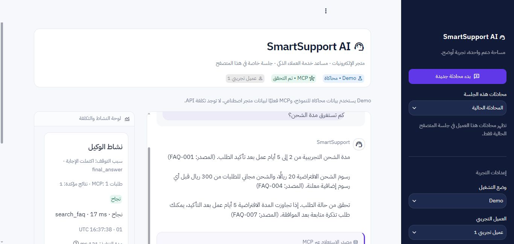
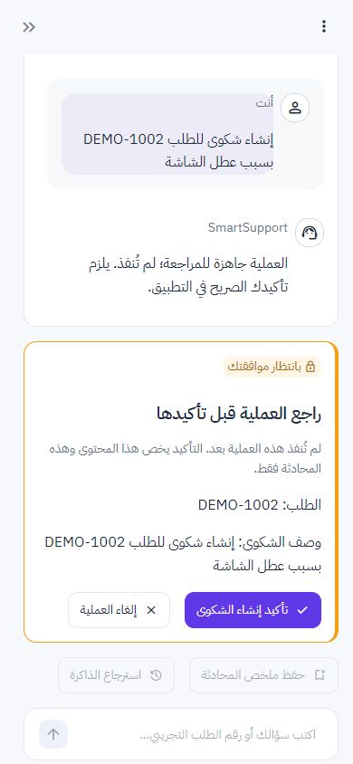

# SmartSupport AI — Production Readiness Audit

تاريخ المراجعة: **2026-11-03**، توقيت العرض Asia/Riyadh. البيئة المختبرة Windows11 / Python3.13.7 / OpenAI SDK2.54.0 / Streamlit1.66.1 / MCP1.27.2 / HTTPX0.28.1. نطاق الحكم منتج يتعامل مع عملاء حقيقيين، لا نموذج عرض أو مشروع تخرج.

## 1. Executive Summary

**الحكم النهائي: NO-GO — غير جاهز للتعامل مع بيانات عملاء حقيقية.** لا يمكن تسليمه الآن كخدمة إنتاج تجارية. يمكن تسليم نسخة Demo ببيانات اصطناعية فقط مع توضيح هذه الحدود، دون تسميتها إصدار إنتاج أو تجربة تجارية مصادقًا عليها.

الأساس المحلي جيد: واجهة Streamlit تستخدم الوكيل الموجود وأدوات MCP الفعلية، وتوجد ضوابط ملكية وموافقة تمنع الكتابة غير المصرح بها أو إعادة استخدام grant ضمن الحالات المختبرة. نجحت 246 حالة pytest. لكن هذه الضوابط لا تنشئ مصادقة مستخدم حقيقية ولا دوام بيانات أو استعادة بعد الأعطال. أثبتت الاختبارات استنفاد تسجيل الزوار بعد 64 زائرًا، وفقد استعادة المحادثة بعد restart كامل، وفجوة المعاملة بين الموافقة وكتابة المتجر. كما كشفت مراجعة الاعتماديات نشرات متطابقة مع إصدارات مثبتة، وفجوات قبول النموذج الحقيقي والوصولية والعمليات.

لا طلبات OpenAI مدفوعة جديدة، ولا نشر أو اختبار ضغط خارجي. الإذن السابق لمهمة FAQ لا يُستخدم إذنًا لتقييم جديد. **العشر حالات الحقيقية المختارة جاهزة وغير منفذة**. لم نعدّل منطق الإنتاج أو مخزن الثقة أو بيانات المتجر الأصلية أو سجلاته؛ [فحص البصمات](evidence/preservation_check.json) يثبت ثبات 84 ملفًا محميًا من خط أساس الاستكمال. التغييرات محصورة في التقارير وأدلتها و fixtures التدقيق.

## 2. النطاق وطريقة الإثبات

مراجعة مستقلة موزعة بين QA/تقييم الوكيل والأمان و SRE، مع مراجعة جامعة للواجهة والتبعيات والتكلفة. فُحصت الحدود البرمجية مع تشغيل فعلي من WebBackend/Streamlit إلى Agent ثم MCP stdio و SQLite. استخدمت 30 حالة عربية المحاكي الحالي غير المعدّل بدل تلقين Fake إجابات ناجحة لكل حالة. اختبارات أعطال منفصلة حقنت فشلًا متعمدًا في fixture فقط. انقطع رصيد مساحة العمل أثناء إعداد التقارير ثم استُكمل العمل من ملفات النتائج؛ نتائج الأداء المكتملة لها timestamps بدء/انتهاء وليست تقديرات مستنتجة من العمل غير المكتمل.

الأدلة الرئيسية: [الوظائف](functional_tests.md)، [التقييم العربي](ai_evaluation.md)، [الأمان](security_audit.md)، [الأداء والاستقرار](performance_report.md)، [المشكلات وخطة الإغلاق](known_issues.md). تفاصيل قابلة لإعادة التشغيل و JSON/JUnit وصور في `reports/evidence/`؛ لا تعرض هذه الأدلة مفاتيح حقيقية.

## 3. نتيجة كل محور A–H

| المحور | النتيجة | الأدلة وحدودها |
| --- | --- | --- |
| A البنية والكود | الضوابط المحلية تعمل؛ البنية غير إنتاجية | مسار UI→WebBackend→AgentWorker→Agent بلا حلقة وكيل ثانية (`app.py:135`، `web_runtime.py:125`). الأدوات الست معرفة `mcp_server.py:77` وتنفذ هناك 143–153. مخططات الأدوات تستبعد الهوية، والـ DB يراجع WHERE/FK؛ لا RLS لحساب يملك ملف SQLite. لا مصادقة تجارية. |
| B الوظائف E2E |10 من 11 معيار قبول نجحت؛ استعادة التطبيق فشلت | [المصفوفة](functional_tests.md): الشحن والاسترجاع والطلبات والشكوى والموافقة/الإلغاء/status وذاكرة العامل. Full restart يبقي صف الذاكرة لكنه لا يستعيد سياقًا مصادقًا عليه. لا كتابة مكررة في الاختبارات المعينة. |
| C جودة الوكيل |26/30 محاكاة ناجحة،4 فاشلة؛ القبول الحقيقي غير مكتمل | [30 حالة مفصلة](ai_evaluation.md). الإخفاقات ORD-05/AMB-01/MT-01/MT-02 في التوضيح/متابعة السياق تخص Demo الحالي. 10 حالات حقيقية مختارة بلا تنفيذ أو تكلفة مزعومة. نجاح FAQ الحي السابق لا يعمم على كل الأدوات أو الحقن. |
| D الأمان | العزل والموافقة/replay محميان في العينات؛ فجوات High باقية |80pytest أمنيًا نجحت.7probes تؤكد 4 ضوابط حماية و 3 فجوات إنتاج. سباق عمليتي MCP على grant واحد أنشأ أثرًا واحدًا فقط. Fake الذي أعاد تعليمات التطبيق قُبل؛ ليس دليل نجاح حقن ضد نموذج حي. XSS المستخدم عُرض كنص في المتصفح. |
| E الاستقرار |توقف آمن في الأعطال؛ لا استعادة/مصالحة إنتاجية |9 تأكيدات حقن أعطال نجحت في رصد السلوك، بما فيه فشل معايير الذرّية والاستعادة. حمل 1→2→4 جلسات و 14 عينة، و 3 رسائل سريعة، دون DB errors.64 زائرًا تاريخيًا تكفي لتعطيل تسجيل زوار جدد. |
| F التكلفة والأداء |الحساب السابق صحيح؛ حجم العينة محدود |[تحقق usage](evidence/cost_verification.json): طلبان،1056/72/cached0،0.001116USD=5.58%من 0.02USD. مهمة حية واحدة فقط؛ ليست متوسطًا أو SLA. [p50/p95 وحجوم العينات](performance_report.md). retries محدودة ولا loop إنفاق غير محدود. |
| G الواجهة |فحص بصري فعلي، مع عيب وصولية وحدود تغطية |Chrome1366×651 ومقاس هاتف 390×844؛ RTL، لا horizontal overflow بالقياسين، مصادر MCP وتمييز simulation والموافقة/الإلغاء وعزل تبويبين موثقة. `html lang=en` خطأ. ليست أجهزة فعلية أو كل المتصفحات أو شهادة WCAG. |
| H جاهزية التشغيل |غير مستوفاة |لا هوية إنتاجية، لا metadata دائم للمحادثات/pending، `/tmp` مؤقت، لا backup restore مثبت، لا تنبيهات/مصالحة/rollback مختبرة. Linux workflow موجود لكن لم ينفذ runner في هذه المراجعة. |

### تحقق A التفصيلي

- **الواجهة والحلقة:** أزرار الواجهة و chat ترسل إلى backend، ثم Agent واحد. DemoOpenAI يكرر سياسة توجيه تجريبية لتوليد ردود Fake، لكنه ليس حلقة تنفيذ ثانية؛ هذا يفسر إخفاقات المحاكي ولا يبرهن إخفاق النموذج الحقيقي.
- **ست أدوات MCP:** search_faq/get_order_status/create_ticket/get_ticket_status/save_memory/load_memory؛ جميعها مكتشفة وتُنفذ عبر ClientSession، لا DB tool بديل داخل Agent.
- **الهوية والذاكرة:** النموذج لا يحدد customer_id/session_id، ومراجع الطلبات والتذاكر تستعمل هوية جلسة الخادم. load/save للذاكرة يقيدان العميل والجلسة. الضابط يفترض أن التطبيق الذي أطلق MCP موثوق، ولا يثبت هوية العميل التجاري.
- **الموافقة:** تُصدر من التطبيق خارج النموذج وتربط payload والهوية والمدة والاستخدام الوحيد. تبديل التفاصيل/replay/سباق موافقة واحدة رُفضت. استهلاك grant ليس ذريًا مع كتابة DB الأخرى.
- **السجلات والأسرار:** JSONL يسجل النجاح والفشل والمصدر والعدادات، مع pseudonym وحقول مسموحة. لا إثبات سجل غير قابل للتلاعب أو مراقبة مركزية. فحص القالب الحالي سليم؛ لا Git في هذه النسخة لتدقيق التاريخ، والتدوير بعد الانكشاف السابق غير مؤكد.
- **التوقف والتكلفة:** max_turns والميزانية و final_answer حالات مستقلة ومختبرة؛ API failure لا يتحول إلى نجاح. SDK retries=0، ومعاودة 429 التطبيقية بحد أقصى مرة ضمن 8 دورات. الحجوزات المجهولة ليست فاتورة مقاسة.
- **الاعتماديات:** فحص OSV اكتمل لـ 61 حزمة:18 مطابقة نشرة تخص 11 ثغرة فريدة في mcp/pip؛ لا Critical مصنفة في النتيجة لكن يوجد High upstream. أغلب المسارات الشبكية غير مفعلة في المشروع. [الانطباق ومصادر المورّد](security_audit.md#مراجعة-الاعتماديات-المعروفة).

## 4. أعداد الاختبارات دون عد مزدوج

| المجموعة | ناجح | فاشل | متخطّى/غير منفذ | التفسير |
| --- | ---: | ---: | --- | --- |
| pytest كامل، دون live_api |246|0|1Linux skipped؛1paid deselected|[JUnit](evidence/baseline_pytest.xml)،138.07 ثانية؛246 ليست عدد معايير الجاهزية المستوفاة |
| pytest أمني فرعي |80|0|0|متداخل مع 246، لا يُضاف إليها |
| تقييم العربية بالمحاكي |26|4|0|30 حالة مستقلة، كل حقائقها وأدواتها وأحكامها في التقرير |
| فحصان وظيفيان إضافيان |1|1|0|رفض grant ناجح؛ استعادة Backend كاملة فاشلة؛ مع المجموعة السابقة 32 نتيجة=27 نجاحًا/5 إخفاقات |
| مصفوفة قبول B |10|1|0|تعيد استخدام النتائج السابقة؛ لا تُجمع معها |
| probes أمان إضافية |7 تأكيدات|0 تأكيدات|0|ترصد 4 معايير ناجحة و 3 معايير فاشلة؛ إعادة إنتاج عيب ليست نجاحًا للمنتج |
| حقن أعطال SRE |9 تأكيدات|0 تأكيدات|0|تثبت توقفًا آمنًا وكذلك وجود فجوة المعاملة وفقد الاستعادة؛ انظر الحكم التفصيلي |
| عينات حمل متدرج |14|0|0|عمليات محلية بمزوّد Fake؛ دون أخطاء DB |
| رسائل سريعة لجلسة دافئة |3|0|0|عينة طابور منفصلة، لا تختبر throughput إنتاجي |
| مجموعة OpenAI الحقيقية المختارة |—|—|10 غير منفذة|لا إذن جديد؛ لا أحكام Pass/Fail أو تكاليف فعلية مصطنعة |

لم نُجرِ Linux أو فحص قارئ شاشة أو استرجاع backup/rollback فعلي؛ هذه فجوات تحقق وليست نجاحات. لا تجمع الجداول لصنع معدل نجاح واحد؛ بعضها متداخل وبعضها يتحقق عمدًا من وجود عيوب.

## 5. مراجعة الواجهة الفعلية

شُغّل Streamlit على `127.0.0.1:8517` مع Public Demo و Live معطل ومجلد منفصل `reports/evidence/ui_fixture`. لا تعديل قاعدة المتجر الأصلية. [نتائج المتصفح](evidence/ui_browser_results.json) و DOM للشحن/pending/confirmation والجلسة الثانية و XSS محفوظة.

| البند | النتيجة |
| --- | --- |
| العربية و RTL |RTL فعلي في computedStyle؛ العربية مقروءة؛ **lang=en يحتاج إصلاحًا** |
| كمبيوتر وهاتف |1366×651 و 390×844؛ document width يساوي viewport في القياسين؛ مقاس محاكى لا هاتف فعلي |
| بدء محادثة وسؤال جاهز |نقرة سؤال الشحن أنتجت إجابة من FAQ مع search_faq مؤكدة |
| المعالجة |رُصد تعطيل الإدخال أثناء الإرسال؛ spinner موجود `app.py:134`؛ لا قياس مستقل لمدة وضوح مؤشر عابر |
| الأداة والتكلفة |MCP تحول من«لم يُتحقق» إلى«تم التحقق»؛ المصدر والأداة والمدة ظاهرة؛ simulation/القيم الاصطناعية واضحة بلا فاتورة حقيقية مزعومة |
| الموافقة |ظهرت تفاصيل العملية والتنبيه قبل الكتابة؛ الإدخال والذاكرة معطلان حتى القرار |
| الإلغاء والتأكيد |الإلغاء أظهر«لم تنفذ الكتابة». بعد تصريح المستخدم المباشر، تأكيد واحد أنشأ تذكرة اصطناعية واحدة عبر create_ticket؛ قواعد التبويبين انتهت بعدد 4 و 3 تذاكر بدل 3 و 3 |
| عزل محادثة |التبويب الثاني بدأ بشاشة جديدة دون رسائل أو تذكرة التبويب الأول؛ هذا ليس اختبار أجهزة/حسابات مصادق عليها |
| XSS |حمولة user ظلت نصًا؛0img محَقونة، لا علامة تنفيذ. مخرجات نموذج خبيثة فُحصت في AppTest فقط |
| الأخطاء |رسائل فشل آمنة مثبتة في AppTest/طبقة التشغيل؛ لم ننفذ كل مسار فشل بصريًا |
| الوصولية |label عربي للإدخال، skip link، أزرار بأسماء، إرسال Enter. قارئ الشاشة/تباين شامل/لوحة مفاتيح كاملة غير مختبرة |

رفضت المراجعة الآلية نقرة التأكيد أولًا لعدم اعتبار تفويض المرفق تصريحًا مباشرًا موثوقًا. لم يُلتف على الرفض؛ طلبنا إذنًا مباشرًا، ثم نُفذت النقرة بعد رد المستخدم«أصرّح بالاختبار الاصطناعي». لا كتابة إنتاجية ولا تفويض مستنتج من صفحة.

## 6. المشكلات حسب الخطورة

القائمة الجامعة في [known_issues.md](known_issues.md): **0Critical مثبتة؛7High؛7Medium؛2Low**. من High: غياب المصادقة، استنفاد سجل الزوار، فقد الاستعادة، تخزين مؤقت دون backup، فجوة الموافقة/الكتابة، تدوير مفتاح منكشف غير مؤكد، وعدم اكتمال قبول النموذج الحقيقي. تصنيف High لا يعني أن كل مشكلة استغلال أمني مثبت؛ بعضها مانع وظيفي/تشغيلي أو فجوة قبول موضحة.

أخطاء المحاكي في التوضيح والتتابع لا تُنسب للنموذج الحي، وغياب output gate لا يساوي إثبات استخراج سر من OpenAI. في المقابل، لا يُخفى أي منهما خلف نجاح pytest أو مثال FAQ واحد.

## 7. Release Blockers

1. **PR-H01:** هوية مستخدم حقيقية وتفويض خادمي مستقل عن اختيار Demo، مع اختبار عزل حسابات مصادقة.
2. **PR-H02:** تنظيف/انتهاء صلاحية الزوار والمحادثات وحدود نشاط قابلة للاستمرار بعد 64 زائرًا.
3. **PR-H03:** كتابة idempotent قابلة للمصالحة أو معاملة ذرية للموافقة والأثر، مع اختبارات كل نقطة crash.
4. **PR-H04/05:** تخزين دائم و metadata دائم للسياق، استعادة آمنة و backup/restore مثبتان؛ SQLite على/tmp لا يفي بذلك.
5. **PR-H06:** إلغاء المفتاح المنكشف وتدويره وتأكيد المشغل، دون إرسال قيمه أو اختبار مدفوع ضمن هذا التدقيق.
6. **PR-H07:** تقييم OpenAI حقيقي مصرح به لحالات القبول، بقواعد موضوعية؛ لا تقيّم النتائج بالنموذج نفسه فقط.
7. بوابة تشغيل مكمّلة: حسم نشرات الاعتماديات، حصص موثوقة وسياسة بيانات ومراقبة وتنبيهات، وإثبات Linux وبروفة إصدار/rollback. ليست Blueprint وحدها دليلًا على جاهزية التشغيل.

## 8. خطة إصلاح مرتبة حسب الأولوية

| الأولوية | العمل المقترح | مسؤولية مقترحة | دليل الإغلاق المطلوب |
| --- | --- | --- | --- |
| P0 | إلغاء المفتاح المنكشف، تعريف حدود البيانات والهوية، تنفيذ تسجيل دخول وتفويض خادمي | مالك الخدمة / أمان / Backend | اختبارات حسابات وعزل ومفاتيح غير مكشوفة؛ تأكيد الإلغاء دون كشف |
| P1 | تخزين دائم وسجل محادثات وعمليات، idempotency ومصالحة، استعادة و backup، تنظيف سجل الزوار | Backend / SRE | أعطال قبل وبعد consume/write/receipt؛ إعادة تشغيل واسترجاع نسخة؛ اختبار churn يتجاوز 64 زائرًا |
| P2 | ترقيات مدروسة و lock، تنقيح logs وسياسة retention، حصص عميل، readiness ومقاييس وتنبيهات | Security / SRE | فحص OSV جديد وتحليل انطباق، CI و restore/rollback، واختبار الحصص عبر المثيلات |
| P2 | تحسين مسارات المحادثة، معالجة lang والوصولية، تنفيذ 10 تقييمات حقيقية بعد تفويض وميزانية مستقلين | QA / Product / AI | تحديد معايير القبول مسبقًا، رفض أي خرق هوية أو موافقة، أحكام موضوعية وتوثيق تكلفة كل حالة |
| P3 | Linux فعلي وحمل أطول ومراجعة نهائية مستقلة | QA / SRE | نتائج runner مرفقة، أحجام عينات ومقاييس بلا تعميم، وإغلاق الموانع قبل قرار إطلاق جديد |

هذه توصيات لم تنفذ كإصلاحات. لا تعني خطة الإصلاح تفويضًا بنشر أو بدء استدعاءات مدفوعة.

## 9. القيود وسلامة الأدلة

- لا يوجد مستودع Git محلي لتدقيق التاريخ أو remotes أو commit محدد؛ رُبطت النتائج ببصمات الملفات بدلًا من ادعاء مراجعة commit.
- Linux وحالة المفاتيح في حساب المزوّد والاستضافة الخارجية غير مختبرة. لا نفترض أن CI نجح لمجرد وجود workflow.
- المفتاح الحقيقي غائب من ملفات التقرير حسب الفحص؛ نُقّح وسم اصطناعي يشبه المفتاح في JUnit مع الحفاظ على أعداد الاختبارات. [إثبات التنقيح](evidence/artifact_redaction.json).
- تعثرت المحاولات الأولى لبعض حزم أدوات التدقيق بسبب إغلاق اتصالات SQLite الاختبارية على Windows؛ أُصلحت أداة التدقيق وحدها ثم أعيد التشغيل. لم تُنسب أخطاء الأداة إلى الإنتاج ولم تُستخدم كقياسات حمل.
- تقرير التكلفة يراجع السجل نفسه ولا ينشئ قياسات جديدة. سجلات المحاكاة محفوظة وموصوفة بالمحاكاة.

## 10. الحكم النهائي

**NO-GO: غير جاهز للتعامل مع بيانات عملاء حقيقية.** الإغلاق المطلوب هندسي وتشغيلي وقبول للنموذج؛ المزيد من pytest وحده لا يعالج هذه الموانع. يجوز عرضه كـ Demo اصطناعي بحدوده الواضحة، دون وعد تسليم خدمة إنتاجية الآن.
