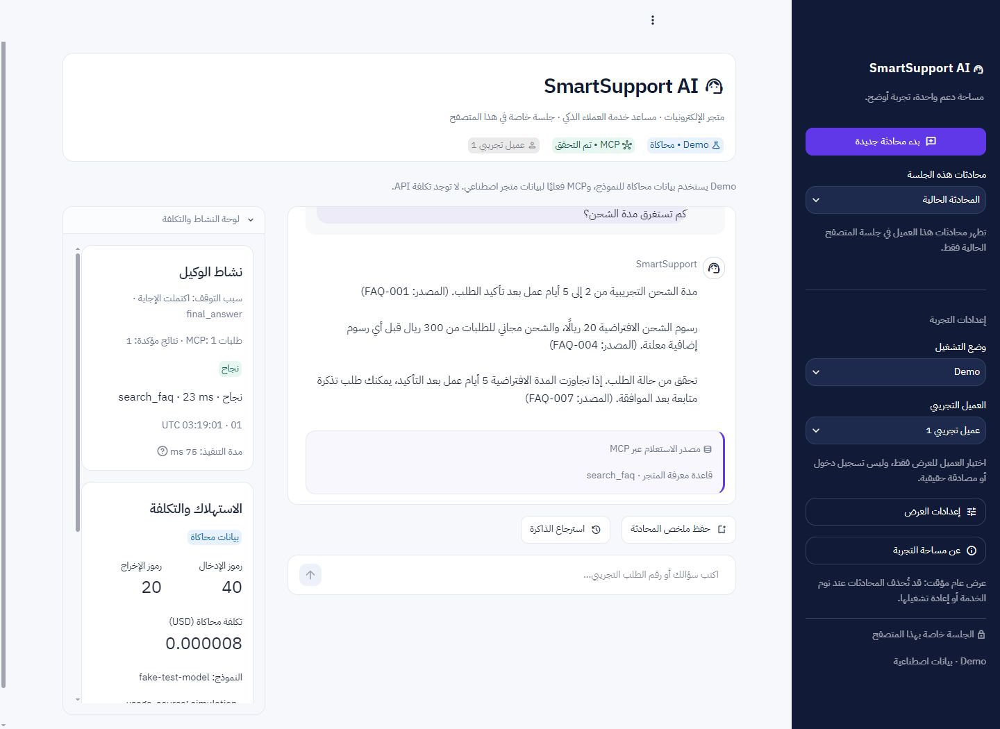

# SmartSupport AI — تقرير واجهة SaaS 3.0

تنفيذ محلي بتاريخ 2026-11-03. الواجهة تهيأت لعرض تجاري، مع بقاء النظام عرضًا ببيانات اصطناعية، دون نشر أو API مدفوع. صورة المرجع لم تكن موجودة ضمن المرفقات المتاحة؛ استُخدمت لوحة الألوان والتخطيط الواردان نصيًا في الطلب.

## الملفات

| الملف | العمل المنفذ |
| --- | --- |
| `app.py` | ثلاث مناطق على الكمبيوتر، ومحادثة أولًا عند ضيق المساحة، ولوحة نشاط قابلة للطي وبتمرير مستقل |
| `ui/components.py` | Header مختصر، بطاقة مصدر من الأدوات الناجحة فقط، خط زمني، وميزانية من البيانات الفعلية |
| `ui/styles.py` | هوية كحلية وبنفسجية، أسطح بيضاء، خط محلي، تباين وتركيز لوحة مفاتيح، وتحول بحسب عرض الحاوية |
| `.streamlit/config.toml` | لوحة الألوان والثيم الداكن والخط وحجم أرقام الاستهلاك؛ إعدادات الأمان باقية |
| `web_runtime.py` | إضافة `activity_timeline` و`budget_usd` إلى لقطة العرض فقط، من التدقيق وإعداد المهمة الفعليين |
| `web_ui.py` | وصف مصنع المورد للنسخة الجديدة؛ لا تغيير للصلاحيات |
| `release_check.py` | استثناء ملفات TTF الثنائية من مسح النص، مع فحص بصمات الخط والترخيص في الاختبارات |
| `tests/test_saas_ui.py` | 12 حالة اختبار إضافية لربط العرض بالمصدر الحقيقي والميزانية والموافقة والخط |
| `assets/fonts/` | خط IBM Plex Sans Arabic بوزنين، وOFL.txt، وتوثيق المصدر والبصمات |
| `README.md` وهذا التقرير | وصف السلوك الحالي والاختبارات والقيود والمعاينات |
| `artifacts/saas-*.jpg` | معاينات فعلية من Chrome ببيانات المتجر الاصطناعية |

لم يُعدل الوكيل أو Responses API أو الأدوات الست أو MCP Server أو النقل أو مخطط SQLite أو مخزن الموافقات أو CostTracker أو AuditLogger أو شروط الكابستون. إضافة معلومات العرض في طبقة التشغيل لا تصدر موافقات ولا تعيد تنفيذ عمليات.

## التصميم والسلوك

الألوان الأساسية `#111B38` و`#6038E8`، والخلفية `#F7F8FC`، والسطح `#FFFFFF`، والنص `#20283D` والثانوي `#68738A`، والحدود `#E5E8F1`، مع الأخضر `#16A573` والبرتقالي `#F59E0B` للحالات. الثيم الداكن يتبع إعداد Streamlit الأصلي. تحقق المتصفح من لون النص الثانوي `rgb(104,115,138)` والأسطح الداكنة `rgb(24,33,61)`، ومن نص زر الموافقة الأبيض فوق `rgb(96,56,232)`.

خط IBM Plex Sans Arabic غير معدل من [Google Fonts الرسمي](https://github.com/google/fonts/tree/main/ofl/ibmplexsansarabic)، تحت SIL OFL 1.1. الترخيص الكامل وبصمات SHA-256 موجودة مع الملفات. الخط يُضمّن من ملفات المشروع باستخدام CSS data URI، ولا يحتاج جلبه من خدمة خطوط خارجية أثناء الاستخدام. بدائل النظام محفوظة، وstatic serving يبقى معطلًا.

على الكمبيوتر، التنقل ثابت يمينًا، والمحادثة أكبر في الوسط، والنشاط يسارًا. لوحة النشاط ذات تمرير مستقل، حتى لا تفرض أحداث مهمة طويلة ارتفاعًا كبيرًا على المحادثة. عند ضيق **عرض مساحة العمل نفسها** تتحول إلى ترتيب رأسي؛ وهذا يعالج جهازًا لوحيًا مع تنقل مفتوح أيضًا. على الهاتف تتقدم المحادثة والإدخال، وتأتي لوحة النشاط القابلة للطي بعدها. لا تُستخدم معلومات المقاس لتحديد الهوية أو الصلاحيات.

CSS يستهدف مفاتيح مكوناتنا والعناصر الدلالية، دون أسماء Emotion المولدة أو testid. استثناء التخطيط هو صف أعمدة Streamlit داخل حاوية `workspace_grid` الخاصة بنا، لتحويله عند ضيق المساحة. اختُبر مع Streamlit 1.66.1؛ يلزم إعادة فحص العرض عند تحديث SDK أو دعم متصفح أقدم لا يوفر CSS container queries أو `:has` أو `light-dark`.

الرسائل عبر `st.text` والنسخ عبر `st.code` فقط. لا HTML خام من العميل أو النموذج. إدخال الرسالة يتعطل أثناء التنفيذ والموافقة، ومخزن الموافقات يظل الحماية الملزمة ضد التكرار. بطاقة المصدر تذكر مصادر الاستعلام والأدوات الناجحة المسجلة لآخر نتيجة؛ لا تصنع إحالات FAQ أو تزعم أن مجرد ذكر مرجع في نص النموذج يجعله موثقًا.

أحداث الأدوات من سجل التدقيق الفعلي، بتوقيت UTC وترتيب التسجيل والمدة والنجاح أو الرفض. حالة انتظار الموافقة مشتقة من pending ولا تُحسب استدعاءً منفذًا. لا تُعرض معاملات أو هوية جلسة أو رموز موافقة أو تفكير داخلي. مؤشر MCP يعني آخر تهيئة حقيقية ناجحة في الجلسة، وليس مراقبة صحة مستمرة.

لوحة الاستهلاك تعرض النموذج والرموز والتكلفة ومصدرها من النتيجة الأصلية. الميزانية مأخوذة من إعداد المهمة الفعلي، والمتبقي محسوب بـDecimal من التقدير الأصلي؛ تُعرض USD كنص عادي لمنع تفسير علامات الدولار كصيغة رياضية. كل قيم Fake OpenAI موسومة «بيانات محاكاة» و`usage_source=simulation`؛ لا توجد قياسات API مدفوعة في هذا التسليم، ولا ضمان لسقف فاتورة نهائي.

## الاختبارات الفعلية

- المجموعة الكاملة: **231 passed، 0 failed، 2 skipped خلال 133.72 ثانية**. الاختباران المتجاوزان: API المدفوع الذي يحتاج إذنًا، وصلاحيات Linux التي تحتاج Linux فعليًا. بقيت الاختبارات السابقة الـ219 ناجحة وأضيف 12 اختبارًا.
- بعد ضبط CSS النهائي أُعيدت اختبارات العرض السابقة والجديدة: **34 passed، 0 failed خلال 47.10 ثانية**. فحص `pip check` سليم، وفاحص الإصدار أعاد صفر نتائج ضمن المسح النصي على قائمة 84 ملفًا مسموحًا بالتوزيع؛ الخطوط الثنائية والصور لا يشملها المسح النصي.
- شملت الاختبارات MCP stdio فعليًا، وملكيات الطلبات والتذاكر، والذاكرة، والموافقة ومنع التكرار، وعزل الزوار، وأخطاء الوكيل والتكلفة والتدقيق والحقن، واختبارات Streamlit السابقة والجديدة.
- الاختبارات الجديدة قارنت أحداث الخط الزمني بأحداث JSONL الفعلية للمهمة، وتحققت من بقاء المهمة والميزانية بعد الموافقة، وعدم اختراع حدث كتابة قبل التأكيد، وعدم إظهار بطاقة مصدر ناجح عند رفض الأداة.
- تحققت من الحد الفعلي للميزانية، والتقدير الزائد أو المفقود أو غير الصالح، ومن استمرار MCP والتدقيق عند إخفاء اللوحة، وبصمات الخط والترخيص وغياب URLs خارجية في CSS الخط.
- فحص قاعدة المطور للقراءة فقط: `integrity_check=ok`، 5 عملاء، 10 طلبات، 3 تذاكر بذور و0 ذاكرة. لم تستخدمها المعاينة أو الاختبارات للكتابة. بصمات traces الثلاثة بقيت مطابقة لتقرير المرحلة السابعة.

## التحقق البصري

شُغلت المعاينة على `http://127.0.0.1:8502/` دون مفتاح، بقفل Demo ومسار `.runtime/ui-saas-preview` المعزول والمستبعد من Git.

| الحالة | النتيجة المنفذة |
| --- | --- |
| كمبيوتر 1440×1050 | ثلاثة أقسام؛ المحادثة قرابة 646 بكسل مقابل 292 للنشاط و300 للتنقل، دون تمرير أفقي |
| لوحي 820×1180 مع تنقل مفتوح | تحول صحيح إلى محادثة ثم نشاط بعرض 478 بكسل، بدل ضغط اللوحة إلى نحو 139 بكسل |
| هاتف 390×844 | محادثة أولًا، وطَي فعلي للنشاط، وتنقل أصلي قابل للفتح، دون تداخل أو تمرير أفقي |
| رد طويل | FAQ متعدد الفقرات مع التفاف عربي وبطاقة مصدر وتمرير داخل المحادثة |
| Loading | تعطيل الإدخال أثناء التنفيذ الفعلي، ثم إعادة تمكينه بعد الرد |
| Approval / Success | استعراض تفاصيل الشكوى وإدخال معطل، ثم تأكيد زر فعلي ورقم تذكرة من MCP في القاعدة المعزولة |
| Error / Denial | رفض `DEMO-2001` للعميل الأول بـ`ACCESS_DENIED`، مع تمييز فشل الأداة دون كشف حالة الطلب |
| المظهر الداكن | أسطح ونصوص مناسبة، وظهور حالة الرفض؛ جُرب التنقل الأساسي بـTab وإعدادات الثيم الأصلية |

المقاسات اختُبرت بمحاكاة viewport في Chrome، وليس على جهاز هاتف فعلي. الألوان وضوحها فُحص بصريًا، وتباين الزر الأساسي محكوم أيضًا باختبار 4.5:1. لا ندعي تدقيق وصول شاملًا أو اختبار جميع قارئات الشاشة والمتصفحات.



[حالة البداية](artifacts/saas-desktop-empty.jpg) · [الميزانية](artifacts/saas-budget.jpg) · [اللوحي](artifacts/saas-tablet.jpg) · [الهاتف](artifacts/saas-mobile.jpg) · [الموافقة](artifacts/saas-approval-mobile.jpg) · [الداكن والرفض](artifacts/saas-dark.jpg)

## القيود والتشغيل

هذه واجهة عرض تجاري فوق نظام Demo، وليست إعلان جاهزية المصادقة أو التخزين الإنتاجيين. الأرشيف خاص بعمر الجلسة والخادم وللقراءة فقط، وSQLite على Render Free مؤقتة، وفجوة المعاملة بين قاعدة الموافقة والمتجر باقية كما سبق. لم تُشغل API مدفوعة ولم يُنشر التطبيق أو يُرفع إلى GitHub.

```powershell
.\.venv\Scripts\python.exe -m streamlit run app.py --server.address 127.0.0.1 --server.port 8502
.\.venv\Scripts\python.exe -m pytest -q
.\.venv\Scripts\python.exe release_check.py
```

أعد تشغيل أي عملية Streamlit قديمة بعد الترقية لتحميل وحدات العرض الجديدة. لا تنشأ قاعدة المطور من هذه الأوامر؛ الواجهة تهيئ مساحات اصطناعية خاصة بالمحادثة.
