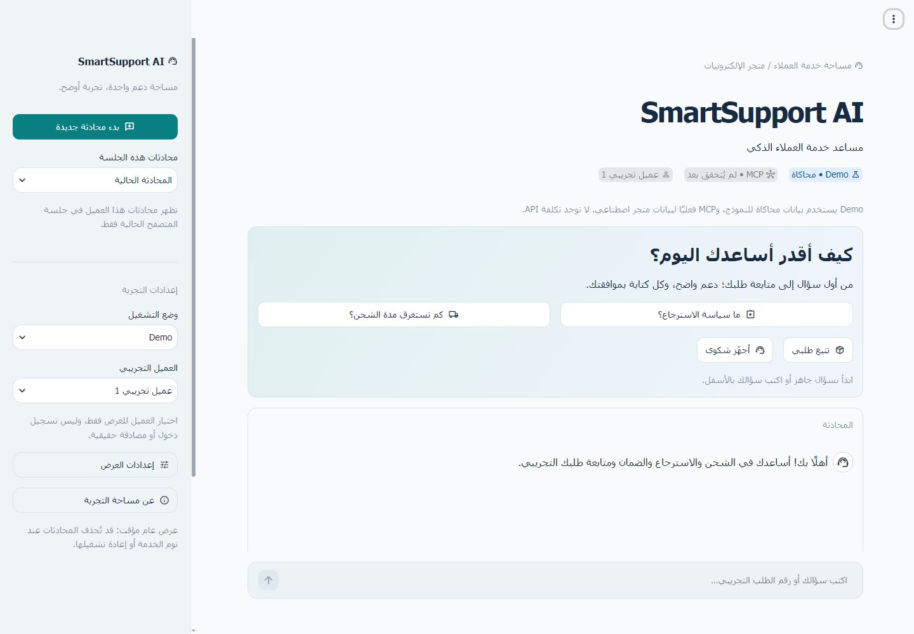

# تقرير إعادة تصميم SmartSupport AI

التاريخ: 2026-11-03. تنفيذ محلي دون OpenAI مدفوع أو نشر عام. أُبقي الوكيل الواحد والأدوات الست وشروط الكابستون ومخزن الموافقات وقاعدة البيانات كما هي.

## الملفات المضافة والمعدلة

| الملف | التغيير |
| --- | --- |
| `app.py` | تنسيق مساحة العميل، الشريط الجانبي والأرشيف، الاقتراحات وحالات القراءة/الموافقة |
| `ui/__init__.py` | حزمة العرض |
| `ui/components.py` | Header وحالة MCP، الحالة الفارغة والدردشة والنسخ، لوحة النشاط والتكلفة وبطاقة الموافقة |
| `ui/styles.py` | CSS ثابت محدود لـRTL وبطاقات محددة بمفاتيحنا واستجابة الهاتف؛ بلا محددات emotion أو testid |
| `.streamlit/config.toml` | ثيمان أصليان فاتح/داكن، خط نظام، حواف مستديرة؛ toolbar للمشاهد دون أدوات المطور |
| `web_runtime.py` | قراءة آمنة لأرشيف الزائر، وبيانات عرض من أحداث التدقيق الفعلية ووقت التنفيذ، وفحص تهيئة Live للواجهة |
| `web_ui.py` | تحديث مصنع المورد المخزن لنسخة الواجهة الجديدة |
| `tests/test_ui_redesign.py` | اختبارات اقتراحات ونشاط وتكلفة وأرشيف ونسخ وإعادة تشغيل وتباين وثيم وصلاحيات |
| `README.md` وهذا التقرير | وصف السلوك والحدود والأوامر والمعاينات الفعلية |
| `artifacts/ui-*.jpg` | خمس لقطات فعلية من المتصفح: الكمبيوتر والهاتف والموافقة والمظهر الداكن ولوحة النشاط |

لم تُعدل `agent.py` أو `mcp_transport.py` أو `approval_store.py` أو `database.py` أو `cost_tracker.py` أو `audit_logger.py` أو `config.py` أو اعتماديات المشروع. لا حلقة وكيل ثانية ولا أداة إضافية.

## السلوك والتحقق

المحتوى عربي RTL، مع إطار Streamlit الأصلي لطي الشريط الجانبي. أُصلح تداخل فعلي في الهاتف كان يسببه قلب اتجاه إطار التطبيق كله؛ المحتوى فقط RTL الآن. الثيمان من إعدادات Streamlit، وليس من تعديل ألوان ديناميكي يعبث بحالة الزوار. الخط Tahoma ثم Arial ثم sans-serif من نظام المتصفح، دون تنزيل خط أو إعادة توزيع ملف خط. الأزرار ذات نص وأيقونة، وتباين النص الأبيض على الزر الأساسي اجتاز نسبة 4.5:1 في الثيمين. هذا تحقق أساسي وليس تدقيق وصول شاملًا.

مؤشر MCP محايد قبل التهيئة؛ بعد نجاح اتصال stdio الحقيقي يعرض آخر تحقق لهذه الجلسة. ليس ping مستمرًا أو ضمان اتصال اللحظة الحالية. لوحة النشاط مستمدة من أحداث `mcp_request` و`mcp_result` للـtask الحالي؛ تعرض الأسماء والحالة والمدة ورمز خطأ مسموحًا فقط. مدة التنفيذ مقاسة داخل العامل ولا تشمل انتظار الموافقة. لا تفكير داخلي أو معاملات خام أو مرجع موافقة في اللوحة.

التكلفة تعرض نتيجة متتبع التكلفة الأصلي؛ Fake OpenAI موسوم «بيانات محاكاة» و`usage_source: simulation`، مع النموذج `fake-test-model`. لا توجد قياسات API فعلية في هذا التسليم. إخفاء لوحة النشاط اختيار عرض فقط ولا يوقف التدقيق أو الصلاحيات.

الأسئلة المقترحة اتصلت بـMCP فعليًا وأعادت FAQ موثقًا. كتابة التذكرة في المتصفح انتظرت زر الموافقة الحقيقي في واجهة المعاينة ثم أعادت رقم تذكرة من SQLite المعزولة. الاختبارات تتحقق من بقاء العدد ثلاث تذاكر بذور قبل التأكيد وأربع بعده، وعدم الزيادة بعد إعادة العرض. الإدخال والذاكرة معطلان أثناء pending، والحماية الملزمة أحادية الاستخدام في طبقة التشغيل وMCP باقية. رفض الطلب `DEMO-2001` للعميل الأول ظهر كـ`ACCESS_DENIED` وفشل/رفض للأداة، دون تأكيد نجاحها.

الأرشيف مملوك لنفس capability والزائر والعميل ووضع التشغيل، وتُرجع طبقته نسخًا مستقلة من البيانات. هو للقراءة فقط، لا يعيد تنشيط مهمة أو موافقة. إعادة تشغيل الخادم تفقد registry الجلسة وتعرض استعادة آمنة إلى سياق جديد؛ لا تعرض محادثة زائر قديم لزائر جديد. اختبارات العزل المتزامن السابقة باقية.

نسخ آخر إجابة متاح اختياريًا عبر مربع `st.code` وزر نسخه الأصلي. الرسائل الأصلية `st.text`؛ اختُبر نص يحتوي `<script>` كنص حرفي، ولم يُرسل إلى Markdown أو HTML. CSS وحده ثابت ومملوك للمشروع. لا تُعرض مفاتيح أو مراجع موافقة.

## المعاينة الفعلية

شُغل Streamlit دون مفتاح على `http://127.0.0.1:8502/` مع مساحة بيانات `.runtime/ui-preview` المعزولة والمستبعدة من Git وقفل Demo. تعذر التقاط قياسات كبيرة سليمة في المتصفح المضمن؛ استُخدم Chrome لإكمال الفحص البصري.

| السيناريو | التحقق |
| --- | --- |
| كمبيوتر 1440×1000 | Header والشريط والبطاقات والاقتراحات والمظهران الفاتح والداكن؛ لا قص أفقي |
| هاتف 390×844 | محاكاة viewport في Chrome، طي الشريط وأزرار ملتفة وبطاقة موافقة واضحة؛ ليس اختبار جهاز هاتف فعلي |
| رسالة طويلة | نص عربي مع مقطع لاتيني متصل من 200 محرف؛ عرض بطاقة المحادثة 346 بكسل وscrollWidth=346 دون تمرير أفقي |
| محادثة وموافقة | FAQ عبر MCP، عرض pending، تأكيد واحد، رقم تذكرة فعلي، ثم إعادة الإدخال |
| حالة فشل | رفض الوصول إلى طلب عميل آخر؛ عرض الرمز والنتيجة الفعلية في لوحة النشاط |
| التكلفة | قيم الرموز والتقدير والنموذج ومصدر المحاكاة ظهرت دون وصفها بأنها فاتورة API |



[الهاتف](artifacts/ui-mobile.jpg) · [الموافقة على الهاتف](artifacts/ui-approval-mobile.jpg) · [المظهر الداكن](artifacts/ui-dark.jpg) · [النشاط والتكلفة](artifacts/ui-dark-activity.jpg)

## الاختبارات والحدود

النتيجة النهائية الفعلية: **219 passed، 0 failed، 2 skipped خلال 149.53 ثانية**. الاختباران المتجاوزان هما OpenAI المدفوع الذي يحتاج تصريحًا صريحًا، وفحص صلاحيات Linux الذي يحتاج نظام Linux فعليًا. بقيت اختبارات المرحلة السابعة الـ207 ناجحة، وأضيف 12 اختبارًا ناجحًا. فحص `pip check` سليم. فاحص الإصدار شمل 71 ملفًا مسموحًا بالتوزيع وأعاد صفر نتائج أسرار ضمن الفحص النصي؛ الصور مستثناة من المسح النصي وفُحصت بصريًا.

شُغلت المجموعة السابقة كاملة دون طلبات API مدفوعة. فحص قاعدة المطور للقراءة فقط أعاد `integrity_check=ok` و5 عملاء و10 طلبات و3 تذاكر و0 ذاكرة، كما قبل التعديلات. بصمات آثار JSONL الثلاثة تطابق البصمات الموثقة في تسليم المرحلة السابعة.

الحدود: لم يُختبر جهاز هاتف فعلي أو قارئ شاشة أو كل المتصفحات. MCP يعرض آخر تحقق لا مراقبة مستمرة. الأرشيف ليس سجل حساب دائمًا؛ لا استعادة هوية إنتاجية بعد إعادة التشغيل. Live لم يُختبر مع مفتاح حقيقي، والنشر العام يظل محظورًا عليه. SQLite المجانية مؤقتة كما في تقرير النشر. لا نشر أو رفع GitHub أو تغيير لشروط التوقف والميزانية.

أمر التشغيل من جذر المشروع، بعد إعادة تشغيل أي نسخة قديمة لتحميل الوحدات الجديدة:

```powershell
.\.venv\Scripts\python.exe -m streamlit run app.py --server.address 127.0.0.1 --server.port 8502
```

لإعادة فحص الواجهة أو المجموعة الكاملة:

```powershell
.\.venv\Scripts\python.exe -m pytest tests/test_ui_redesign.py tests/test_streamlit_app.py -q
.\.venv\Scripts\python.exe -m pytest -q
.\.venv\Scripts\python.exe release_check.py
```
